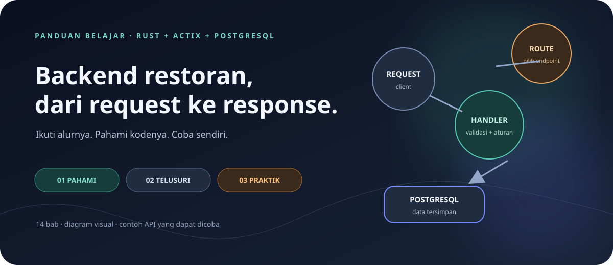
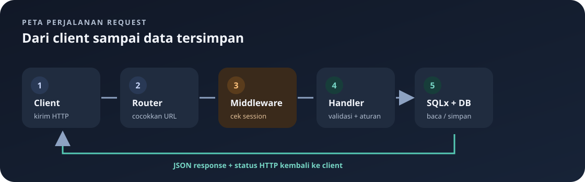

# 🍽️ Belajar Backend Restoran



> **Tujuan panduan:** membantu kamu memahami cara request masuk, diperiksa, diproses, disimpan, lalu dikirim kembali sebagai response. Semua catatan merujuk pada kode backend di folder ini.

Kamu tidak harus membaca semuanya sekaligus. Pilih salah satu jalur di bawah, pelajari satu konsep, lalu jalankan contoh kecilnya. Istilah teknis dijelaskan saat pertama kali diperlukan.

## Pilih cara belajar

| Kalau kamu… | Mulai dari… | Hasil yang diharapkan |
|---|---|---|
| Ingin belajar bertahap selama enam bulan | [Roadmap belajar](roadmap-belajar-6-bulan.md) | Memiliki target mingguan dan evaluasi berbasis bukti. |
| Baru mengenal backend | [Jalur pemula](#jalur-pemula) | Paham gambaran besar sebelum melihat detail kode. |
| Ingin API segera jalan | [Menyalakan server](#menyalakan-server) | Server aktif dan siap menerima request lokal. |
| Ingin mencoba API | [Latihan `curl`](akses_curl.md) | Bisa register, login, dan mengelola menu/pesanan. |
| Sedang membaca satu file | [Peta file](#peta-file) | Langsung masuk ke penjelasan file terkait. |

## Jalur pemula

Ikuti urutan ini. Setiap langkah menjawab satu pertanyaan sebelum masuk ke bagian berikutnya.

| Langkah | Pertanyaan yang dijawab | Baca |
|---:|---|---|
| 1 | Dari mana aplikasi mendapat alamat server dan kunci session? | [Konfigurasi `.env`](env.md) |
| 2 | Pustaka apa yang membangun API ini? | [Dependency Cargo](cargo.md) |
| 3 | Apa yang terjadi ketika program mulai? | [Startup](main.md) |
| 4 | Bagaimana handler berbagi koneksi database? | [State aplikasi](state.md) |
| 5 | Seperti apa bentuk data masuk dan keluar? | [Model data](models.md) |
| 6 | Di mana data disimpan dan aturan apa yang menjaganya? | [Skema database](db.md) |
| 7 | Bagaimana URL menemukan fungsi yang benar? | [Routing](routes.md) |
| 8 | Bagaimana server tahu pengguna sudah login? | [Autentikasi dan middleware](auth-middleware.md) |
| 9 | Bagaimana mencoba alur itu dari terminal? | [Latihan `curl`](akses_curl.md) |
| 10 | Bagaimana handler menjalankan operasi nyata? | [Auth](handlers/auth.md), [menu](handlers/menus.md), [pesanan](handlers/orders.md) |

**Pola yang akan sering terlihat:** ambil input → periksa → query database → bentuk response.

### Latihan belajar 20 menit

| Waktu | Lakukan | Periksa bahwa kamu bisa… |
|---:|---|---|
| 5 menit | Baca [urutan startup](main.md) dan [diagram request](#gambaran-besar-dalam-satu-gambar). | Menjelaskan kapan server mulai menerima request. |
| 5 menit | Ikuti bagian register/login di [latihan `curl`](akses_curl.md). | Menjelaskan mengapa cookie perlu disimpan. |
| 5 menit | Buat satu menu, lalu baca daftar menu. | Menemukan hubungan route → handler → query. |
| 5 menit | Coba PATCH harga dan baca lagi menu. | Menjelaskan `Option` dan `COALESCE` secara sederhana. |

Tidak perlu menghafal nama semua tipe. Cukup ikuti alur data dari request sampai response; nama fungsi bisa dicari pada [peta file](#peta-file).

## Gambaran besar dalam satu gambar



Bayangkan restoran: **router** seperti petugas yang mengarahkan pesanan, **middleware** seperti pemeriksaan akses sebelum masuk, **handler** seperti bagian dapur yang mengolah permintaan, dan **database** seperti buku catatan yang menyimpan hasilnya.

**Petunjuk warna diagram:** navy menandai struktur utama, hijau kebiruan menandai data/alur sukses, dan jingga menyorot pemeriksaan atau hal yang perlu diperhatikan.

### Urutan satu request

```text
Client → Route → (Session check) → Handler → Validasi → SQL → Database
Client ← JSON + status ← Handler ← Hasil query ← Database
```

Setiap file punya bagian dari alur ini. Jika satu istilah terasa abstrak, cari contoh konkretnya di latihan `curl`.

## Menyalakan server

### Yang diperlukan

- Rust dan Cargo.
- PostgreSQL yang berjalan, serta sebuah database yang bisa diakses.
- File `.env` di folder backend. Lihat [cara mengisinya](env.md); jangan membagikan nilainya.

### Jalankan

```bash
cargo run
```

Jalankan perintah dari folder yang berisi `Cargo.toml`. Server default mendengarkan di `http://127.0.0.1:8080`. Biarkan terminal ini hidup, lalu buka terminal kedua untuk mengikuti [latihan API](akses_curl.md).

> **Jika server gagal mulai:** baca error paling awal di terminal. `DATABASE_URL`/PostgreSQL biasanya bermasalah sebelum aplikasi menerima request; `SESSION_KEY` yang hilang atau panjangnya keliru juga menghentikan startup.

## Peta file

| Bagian | Catatan belajar | Peran sederhananya |
|---|---|---|
| `.env` | [Konfigurasi](env.md) | Menyediakan nilai lokal seperti URL database. |
| `Cargo.toml` | [Dependency](cargo.md) | Mencatat pustaka yang dipakai. |
| `src/main.rs` | [Startup](main.md) | Merangkai semua bagian dan menyalakan server. |
| `src/state.rs` | [State](state.md) | Membagikan pool database kepada handler. |
| `src/db.rs` | [Skema database](db.md) | Membuat tabel saat startup. |
| `src/models.rs` | [Model](models.md) | Mendefinisikan bentuk data Rust. |
| `src/routes.rs` | [Route](routes.md) | Menghubungkan URL dan metode ke fungsi handler. |
| `src/auth_middleware.rs` | [Middleware login](auth-middleware.md) | Menolak request terlindungi tanpa session. |
| `src/handlers/mod.rs` | [Modul handler](handlers/mod.md) | Memberi tahu Rust file handler yang tersedia. |
| `src/handlers/auth.rs` | [Autentikasi](handlers/auth.md) | Register, login, logout, dan profil. |
| `src/handlers/format.rs` | [Format harga](handlers/format.md) | Menulis harga dalam format Rupiah. |
| `src/handlers/menus.rs` | [Handler menu](handlers/menus.md) | Operasi data menu. |
| `src/handlers/orders.rs` | [Handler pesanan](handlers/orders.md) | Operasi data pesanan. |

## API yang bisa dicoba

Semua alamat memakai awalan `/api`. `Ya` berarti client perlu mengirim cookie hasil login.

| Metode | Path | Login | Aksi |
|---|---|:---:|---|
| `POST` | `/api/auth/register` | Tidak | Membuat akun. |
| `POST` | `/api/auth/login` | Tidak | Memeriksa akun dan mengirim cookie session. |
| `POST` | `/api/auth/logout` | Tidak | Menghapus session yang dikirim. |
| `GET` | `/api/auth/me` | Ya | Mengambil identitas akun aktif. |
| `GET` | `/api/menus` | Ya | Membaca daftar menu; `?field=name` memilih satu kolom. |
| `GET` | `/api/menus/{id}` | Ya | Membaca satu menu. |
| `POST` | `/api/menus` | Ya | Menambah menu. |
| `PUT` / `PATCH` | `/api/menus/{id}` | Ya | Mengganti semua / sebagian field. |
| `DELETE` | `/api/menus/{id}` | Ya | Menghapus menu. |
| `GET` | `/api/orders` | Ya | Membaca daftar pesanan; `?field=status` memilih satu kolom. |
| `GET` | `/api/orders/{id}` | Ya | Membaca satu pesanan. |
| `POST` | `/api/orders` | Ya | Menambah pesanan. |
| `PUT` / `PATCH` | `/api/orders/{id}` | Ya | Mengganti semua / sebagian field. |
| `DELETE` | `/api/orders/{id}` | Ya | Menghapus pesanan. |

Untuk semua field dan contoh request/response, buka [daftar route lengkap](routes.md) atau bab [menu](handlers/menus.md) dan [pesanan](handlers/orders.md).

### Dua bentuk data penting

Menu:

```json
{"name":"Nasi Goreng","price":25000,"category":"Makanan"}
```

Pesanan:

```json
{"customer_name":"Budi","item_name":"Nasi Goreng","quantity":2,"status":"pending"}
```

`POST` dan `PUT` memerlukan semua field. `PATCH` hanya memerlukan field yang ingin diubah. Teks harus berisi sesuatu setelah spasi tepinya dibuang; harga dan jumlah harus lebih besar dari nol.

> **Perhatikan response:** beberapa GET mengirim array dengan urutan kolom tetap; operasi create/update/PATCH mengirim object. Harga pada GET menu sudah berupa teks, misalnya `Rp25.000`. Detail response per endpoint ada di bab handler.

## Status yang sering muncul

| Status | Arti cepat | Contoh penyebab |
|---|---|---|
| `200` | Berhasil | Membaca atau memperbarui data. |
| `201` | Data baru dibuat | Register, create menu/pesanan. |
| `400` | Input perlu diperbaiki | Harga nol, JSON atau field keliru. |
| `401` | Login diperlukan/gagal | Cookie belum dikirim atau kredensial salah. |
| `404` | Data tidak ditemukan | ID tidak ada. |
| `409` | Ada benturan | Username sudah dipakai. |
| `500` | Server gagal memproses | Query atau database bermasalah. |

Periksa **status dan body JSON bersama-sama**. Status menunjukkan kelompok hasil; body biasanya memberi pesan yang lebih spesifik.

## Batas implementasi yang perlu diketahui

> ⚠️ **Hanya untuk belajar lokal.** Password saat ini disimpan sebagai teks biasa. Jangan gunakan password sungguhan dan jangan deploy implementasi ini sebagai aplikasi produksi.

Session cookie dilindungi `SESSION_KEY`, tetapi konfigurasi cookie saat ini mengizinkan HTTP lokal. Untuk deployment diperlukan HTTPS dan cookie Secure. File cookie dari latihan juga bersifat rahasia.

Pesanan menyimpan `item_name` sebagai teks; belum ada relasi foreign key ke tabel menu. `status` juga berupa teks bebas. Middleware memeriksa bahwa `user_id` ada, tetapi belum ada role atau izin berbeda per akun.

## Cara membaca contoh Rust

| Bentuk | Cara mengingat |
|---|---|
| `Option<T>` | Nilai mungkin ada: `Some(...)`, atau kosong: `None`. |
| `Result<T, E>` | Hasil bisa sukses `Ok(...)` atau gagal `Err(...)`. |
| `?` | Jika operasi gagal, kembalikan error dari fungsi sekarang. |
| `.await` | Tunggu operasi asynchronous, biasanya I/O atau query. |
| `.bind(value)` | Kirim nilai SQL terpisah dari teks query. |
| `web::Json<T>` | Minta Actix membaca body JSON menjadi tipe `T`. |
| `web::Path<T>` | Ambil nilai dari bagian dinamis URL. |

### Cek pemahaman

1. Dalam alur request, apa yang terjadi sebelum handler untuk route menu dipanggil?
2. Apa beda `PUT` dan `PATCH` pada API ini?
3. Mengapa query menggunakan `.bind(...)`?

Jawabannya ada di [middleware](auth-middleware.md), [routing](routes.md), dan bab [handler menu](handlers/menus.md).

<details>
<summary>Lihat jawaban ringkas</summary>

1. Middleware memeriksa session pada route terlindungi; tanpa `user_id`, request berhenti dengan `401`.
2. `PUT` meminta semua field yang dapat diubah, sementara `PATCH` cukup mengirim field yang ingin diganti.
3. `.bind(...)` mengirim nilai sebagai parameter terpisah dari SQL, sehingga input tidak dirangkai menjadi teks query.

</details>

---

Kembali ke [README proyek](../README.md).

