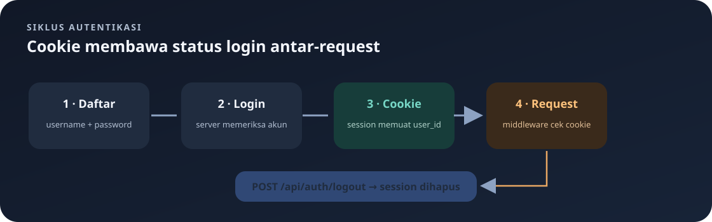

# Mengakses API dengan `curl`

Panduan ini menunjukkan cara mengirim request ke backend menggunakan `curl` dari terminal Linux. `curl` adalah program untuk mengirim request HTTP dan menampilkan response server.

Navigasi: [indeks catatan belajar](README.md).

> **Inti bab:** `curl` mengirim request HTTP dari terminal. Untuk endpoint terlindungi, simpan cookie saat login lalu lampirkan cookie itu pada request berikutnya.

### Isi panduan

1. [Persiapan](#sebelum-mulai)
2. [Membaca perintah `curl`](#memahami-bentuk-perintah)
3. [Register dan login](#1-membuat-akun)
4. [Membaca dan mengubah menu/pesanan](#4-membaca-menu-dan-pesanan)
5. [Logout](#8-logout)
6. [Status dan pemecahan masalah](#arti-status-yang-sering-terlihat)

## Sebelum Mulai

1. Pastikan PostgreSQL berjalan dan database sudah tersedia.
2. Pastikan `.env` sudah memiliki `DATABASE_URL` dan `SESSION_KEY` yang valid.
3. Jalankan server dari folder backend dengan `cargo run`.
4. Biarkan terminal server tetap berjalan. Buka terminal kedua untuk mengetik perintah `curl`.

Secara default, server memakai alamat `http://127.0.0.1:8080`. Berikut variabel Bash agar alamat tidak perlu diketik berulang kali:

```bash
BASE_URL="http://127.0.0.1:8080"
```

Salin perintah tersebut ke terminal yang akan dipakai untuk `curl`. Jika kamu mengubah `HOST` atau `PORT` di `.env`, sesuaikan `BASE_URL`.

## Memahami Bentuk Perintah

Contoh berikut membuat menu. Bagian sesudah `curl` adalah opsi dan nilai yang mengatur request:

```bash
curl -i -b cookies.txt -X POST "$BASE_URL/api/menus" \
  -H "Content-Type: application/json" \
  -d '{"name":"Nasi Goreng","price":25000,"category":"Makanan"}'
```

Arti setiap bagian:

<details>
<summary>🔎 Penjelasan opsi curl dan tanda kutip (buka jika ingin tahu detailnya)</summary>

- `curl` menjalankan program klien HTTP dari terminal. Program ini mengirim request ke URL dan menampilkan hasilnya.
- `-i` (sama dengan `--include`) menyertakan header response di keluaran, sebelum body response. Dari sini kamu dapat melihat status seperti `HTTP/1.1 201 Created` dan header seperti `Set-Cookie`. Opsi ini hanya menampilkan header response; bukan untuk mengirim header request.
- `-b cookies.txt` (sama dengan `--cookie cookies.txt`) membaca cookie dari file lalu mengirimkannya ke server. Di panduan ini cookie tersebut membuktikan bahwa kamu sudah login. Opsi ini berbeda dari `-c`, yang menyimpan cookie dari response.
- `-X POST` (sama dengan `--request POST`) menentukan metode HTTP sebagai `POST`. Metode memberi tahu server jenis operasi yang diminta. `GET` adalah default untuk request tanpa body; `-X GET` biasanya tidak perlu ditulis. `-X` hanya menetapkan nama metode, bukan membuat atau memformat body.
- `"$BASE_URL/api/menus"` adalah URL tujuan. `$BASE_URL` diganti oleh Bash dengan nilai variabel yang sebelumnya diatur. Tanda petik ganda menjaga URL tetap menjadi satu argumen dan membantu mencegah karakter khusus shell ditafsirkan secara tidak sengaja.
- `-H "Content-Type: application/json"` (sama dengan `--header`) mengirim header request. `Content-Type` menyatakan format body yang dikirim; `application/json` berarti server harus membaca body sebagai JSON. Ini bukan header response.
- `-d '{...}'` (sama dengan `--data`) mengirim data sebagai body request. Penggunaan `-d` membuat `curl` memakai metode `POST` secara default, sehingga `-X POST` pada contoh menegaskan maksudnya. Tanda petik tunggal Bash di luar JSON menjaga tanda petik ganda di dalam JSON tetap utuh. Nilai teks JSON memakai tanda petik ganda, sedangkan angka seperti `25000` tidak.
- `\` di ujung baris adalah cara Bash menyambung perintah ke baris berikutnya agar mudah dibaca. Harus menjadi karakter terakhir pada baris tersebut; jangan menaruh spasi sesudahnya. Tanpa `\`, tulis seluruh perintah dalam satu baris.

Opsi lain yang dipakai dalam panduan:

- `-c cookies.txt` (sama dengan `--cookie-jar cookies.txt`) menyimpan cookie yang diterima dari response ke file. Gunakan saat login agar cookie session dapat dipakai pada request berikutnya. Opsi ini tidak berarti mengirim cookie lama; untuk itu gunakan `-b cookies.txt`.
- `-X PUT`, `-X PATCH`, dan `-X DELETE` menetapkan metode untuk mengganti data, mengubah sebagian data, dan menghapus data. `-X` selalu menentukan metode; endpoint server yang menentukan operasi dan format data yang diterima.
- `?field=price` pada URL memulai query string. `field` adalah nama parameter dan `price` nilainya. `?` merupakan pemisah antara path endpoint dan parameter, bukan opsi `curl`.
- `/1` pada URL adalah bagian path yang digunakan endpoint ini sebagai ID data. Ganti `1` dengan ID menu atau pesanan yang ingin dituju.
- `-i` tidak wajib untuk mengirim request. Hapus opsi ini bila hanya ingin melihat body response, bukan header-nya.

Tanda petik dan perintah shell yang juga muncul:

- `"..."` mengelompokkan teks sebagai satu argumen sambil tetap memungkinkan Bash mengganti variabel seperti `$BASE_URL`.
- `'...'` mempertahankan isi secara literal. Karena itu, JSON di contoh ditulis dengan petik tunggal di luar dan petik ganda untuk nama field serta teks JSON.
- `BASE_URL="http://127.0.0.1:8080"` membuat variabel Bash bernama `BASE_URL`. Variabel ini hanya tersedia pada terminal/sesi shell tempat kamu mengaturnya.
- `umask 077` mengatur izin default file baru agar hanya pemilik akun yang dapat membaca atau mengubahnya. Jalankan sebelum login untuk melindungi file cookie yang dibuat.
- `rm cookies.txt` menghapus file cookie lokal. Perintah ini tidak menghapus akun atau data dari database.

Ringkasnya, `-H` dan `-d` menjelaskan data yang dikirim, `-b` dan `-c` menangani cookie, `-X` memilih metode, sedangkan `-i` membantu memeriksa response. Opsi dapat digabung; urutan opsi di contoh-contoh ini dibuat agar mudah dibaca.

</details>

## 1. Membuat Akun

Kirim request register. Username harus unik dan password minimal 8 byte menurut pemeriksaan kode saat ini. Untuk huruf ASCII, batas tersebut setara dengan delapan karakter; karakter Unicode bisa menggunakan lebih dari satu byte.

```bash
curl -i -X POST "$BASE_URL/api/auth/register" \
  -H "Content-Type: application/json" \
  -d '{"username":"yofan","password":"contoh-password-123"}'
```

Jika berhasil, response biasanya berstatus `201 Created`:

```json
{"message":"Akun berhasil dibuat"}
```

Jika username tersebut sudah pernah didaftarkan, server merespons `409 Conflict`. Gunakan username lain atau login dengan akun yang sudah ada. Contoh password di panduan ini hanya untuk pengujian lokal; jangan pakai sebagai password akun sungguhan.

## 2. Login dan Simpan Cookie



Session login dikirim sebagai cookie HTTP. Opsi `-c cookies.txt` meminta `curl` menyimpan cookie response ke file `cookies.txt`.

```bash
curl -i -c cookies.txt -X POST "$BASE_URL/api/auth/login" \
  -H "Content-Type: application/json" \
  -d '{"username":"yofan","password":"contoh-password-123"}'
```

Jika berhasil, body response berisi:

```json
{"message":"Login berhasil"}
```

File cookie berisi bukti login. Jangan bagikan file tersebut atau unggah ke Git. Untuk membatasi akses file di Linux, kamu dapat membuat cookie jar dengan hak akses privat:

```bash
umask 077
```

Jalankan `umask 077` sebelum request login membuat `cookies.txt`.

## 3. Mengirim Cookie pada Request Berikutnya

Opsi `-b cookies.txt` membaca cookie dari file dan mengirimkannya ke server. Semua endpoint menu dan pesanan, serta `/api/auth/me`, memerlukan cookie login.

Cek akun yang sedang login:

```bash
curl -i -b cookies.txt "$BASE_URL/api/auth/me"
```

Contoh response sukses:

```json
{"id":1,"username":"yofan"}
```

Jika menjalankan request ini tanpa login atau tanpa `-b cookies.txt`, hasilnya `401 Unauthorized` dengan pesan login diperlukan.

## 4. Membaca Menu dan Pesanan

Ambil semua menu:

```bash
curl -i -b cookies.txt "$BASE_URL/api/menus"
```

Ambil satu menu berdasarkan ID:

```bash
curl -i -b cookies.txt "$BASE_URL/api/menus/1"
```

Ambil hanya harga menu. Tanda `?` memulai query string; `field=price` adalah parameter query:

```bash
curl -i -b cookies.txt "$BASE_URL/api/menus?field=price"
```

Ambil semua pesanan atau satu kolom pesanan:

```bash
curl -i -b cookies.txt "$BASE_URL/api/orders"
curl -i -b cookies.txt "$BASE_URL/api/orders?field=status"
```

## 5. Membuat Data

Request `POST` memerlukan header JSON dan body dengan field yang sesuai.

Membuat menu:

```bash
curl -i -b cookies.txt -X POST "$BASE_URL/api/menus" \
  -H "Content-Type: application/json" \
  -d '{"name":"Nasi Goreng","price":25000,"category":"Makanan"}'
```

Membuat pesanan:

```bash
curl -i -b cookies.txt -X POST "$BASE_URL/api/orders" \
  -H "Content-Type: application/json" \
  -d '{"customer_name":"Budi","item_name":"Nasi Goreng","quantity":2,"status":"pending"}'
```

Jika berhasil, operasi pembuatan mengembalikan `201 Created` dan data yang baru dibuat. Sesuaikan menu dan pesanan dengan kebutuhanmu.

## 6. Mengubah Data

`PUT` mengganti semua field yang diminta oleh input lengkap. Ganti angka `1` dengan ID data yang benar.

```bash
curl -i -b cookies.txt -X PUT "$BASE_URL/api/menus/1" \
  -H "Content-Type: application/json" \
  -d '{"name":"Nasi Goreng Spesial","price":30000,"category":"Makanan"}'
```

`PATCH` hanya mengubah field yang dikirim. Field lain tetap memakai nilainya sekarang.

```bash
curl -i -b cookies.txt -X PATCH "$BASE_URL/api/menus/1" \
  -H "Content-Type: application/json" \
  -d '{"price":27500}'
```

Contoh mengubah status pesanan:

```bash
curl -i -b cookies.txt -X PATCH "$BASE_URL/api/orders/1" \
  -H "Content-Type: application/json" \
  -d '{"status":"diproses"}'
```

## 7. Menghapus Data

Hati-hati: `DELETE` menghapus data dengan ID tersebut dari database.

```bash
curl -i -b cookies.txt -X DELETE "$BASE_URL/api/menus/1"
curl -i -b cookies.txt -X DELETE "$BASE_URL/api/orders/1"
```

## 8. Logout

Logout menghapus session. `-b` mengirim cookie yang sekarang, dan `-c` memperbarui cookie jar dari response logout.

```bash
curl -i -b cookies.txt -c cookies.txt -X POST "$BASE_URL/api/auth/logout"
```

Sesudah logout, request terlindungi dengan cookie jar tersebut seharusnya ditolak sebagai `401 Unauthorized`:

```bash
curl -i -b cookies.txt "$BASE_URL/api/auth/me"
```

Untuk mulai lagi, lakukan login kembali dan simpan cookie baru ke `cookies.txt`.

## Arti Status yang Sering Terlihat

| Status | Makna umum dalam API ini |
|---|---|
| `200 OK` | Request berhasil, misalnya membaca data atau login. |
| `201 Created` | Akun, menu, atau pesanan berhasil dibuat. |
| `400 Bad Request` | JSON tidak valid atau nilai input tidak memenuhi aturan. |
| `401 Unauthorized` | Belum login, cookie tidak dikirim, atau password salah. |
| `404 Not Found` | ID menu/pesanan tidak ditemukan. |
| `409 Conflict` | Username sudah digunakan. |
| `500 Internal Server Error` | Server atau database mengalami kegagalan. |

## Masalah Umum

- **`curl: (7) Failed to connect`**: server belum berjalan, atau `BASE_URL` memakai host/port yang salah.
- **`401 Unauthorized` pada menu/pesanan**: login dulu, lalu tambahkan `-b cookies.txt` pada request.
- **Login selalu gagal**: pastikan akun sudah dibuat dan username/password sama persis.
- **Register menghasilkan 409**: username sudah ada di tabel `"user"`; gunakan username berbeda.
- **`400 Bad Request`**: periksa ejaan nama field JSON, tanda kutip, koma, serta tipe nilai seperti `price` dan `quantity`.
- **File `cookies.txt` hilang**: jalankan login dengan `-c cookies.txt` lagi.

## Keamanan

Cookie jar adalah kredensial session: siapa pun yang memilikinya dapat bertindak sebagai akun yang login sampai session dibersihkan atau tidak lagi berlaku. Simpan file di komputer sendiri, jangan kirim ke orang lain, dan hapus setelah selesai menguji:

```bash
rm cookies.txt
```

Perintah hapus tersebut menghapus cookie jar lokal. Jangan gunakan HTTP untuk mengirim cookie melalui jaringan publik; deployment seharusnya memakai HTTPS.
