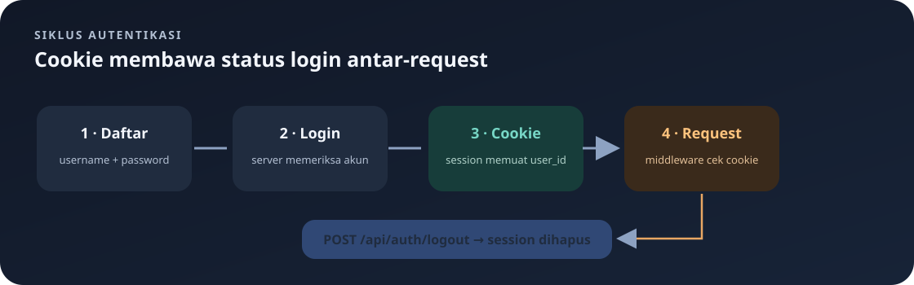

# `src/auth_middleware.rs`

File ini berisi middleware yang membatasi akses ke endpoint tertentu. Middleware adalah lapisan kecil yang dijalankan sebelum handler utama. Dalam proyek ini, middleware memeriksa apakah request memiliki session dengan `user_id`.

Navigasi: [indeks](README.md) · [routing](routes.md) · [handler autentikasi](handlers/auth.md).

> **Inti bab:** middleware menghentikan request terlindungi sebelum handler jika session tidak memuat `user_id` bertipe integer.

File sumber: [auth_middleware.rs](../src/auth_middleware.rs).

## Mengapa Middleware Dibutuhkan?

Tanpa pemeriksaan ini, setiap handler menu atau pesanan harus mengulang kode pengecekan login. Middleware mengumpulkan pemeriksaan tersebut di satu tempat. `routes.rs` memasang middleware hanya pada scope yang perlu dilindungi.

Middleware ini tidak memeriksa username atau password lagi. Tugas itu dilakukan saat login. Middleware hanya memastikan session request saat ini berisi nilai `user_id` bertipe integer.

## Import

- `SessionExt` memberi `ServiceRequest` method `get_session()` untuk membaca session.
- `ServiceRequest` adalah request Actix yang masih berada di pipeline middleware.
- `ServiceResponse` adalah response setelah request diteruskan.
- `MessageBody` adalah trait untuk tipe body HTTP.
- `Next` mewakili middleware atau handler berikutnya dalam rantai.
- `ErrorUnauthorized` membuat error HTTP 401.

## Fungsi `require_login`

```rust
pub async fn require_login(
    request: ServiceRequest,
    next: Next<impl MessageBody>,
) -> Result<ServiceResponse<impl MessageBody>, Error>
```

Fungsi asynchronous menerima request dan objek `next`. Hasilnya `Ok(response)` jika request boleh diteruskan, atau `Err(error)` jika belum login.

Bagian pemeriksaan:

```rust
let authenticated = matches!(
    request.get_session().get::<i32>("user_id"),
    Ok(Some(_))
);
```

`get::<i32>("user_id")` mencoba mengambil nilai session dengan key bernama `user_id` sebagai `i32`. Hasilnya bertingkat: operasi dapat gagal (`Err`), berhasil tetapi nilai tidak ada (`Ok(None)`), atau berhasil dengan nilai (`Ok(Some(id))`). `matches!` mengembalikan `true` hanya untuk `Ok(Some(_))`. `_` berarti nilai ID ada, tetapi tidak perlu diikat ke nama baru.

Jika nilai tidak ada atau pembacaan session gagal, kondisi berikut mengembalikan HTTP 401:

```rust
if !authenticated {
    return Err(ErrorUnauthorized("Login diperlukan"));
}
```

Tanda `!` berarti NOT. Jadi blok dijalankan ketika `authenticated` bernilai `false`.

Jika session valid, `next.call(request).await` meneruskan request ke route/handler berikutnya. Hasil response diteruskan kembali ke client.

## Tempat Middleware Dipasang

Pada `routes.rs`, `from_fn(require_login)` dipasang pada scope `/api/menus` dan `/api/orders`, serta resource `/api/auth/me`. Akibatnya seluruh route dalam dua scope tersebut memerlukan session, bukan hanya operasi tulis. Endpoint register dan login tidak diproteksi agar pengguna dapat memulai sesi. Logout juga tidak diproteksi; ia dapat menghapus session bila request mengirim cookie.

## Batas Perlindungan Saat Ini

- Middleware hanya memeriksa apakah `user_id` ada; belum ada pemeriksaan role atau izin per pengguna.
- Handler logout dapat dipanggil tanpa login; memanggil `purge()` pada session kosong tetap menghasilkan respons logout berhasil.
- Route yang tidak diberi middleware tetap dapat diakses tanpa login.
- Pada production, gunakan HTTPS dan cookie Secure; konfigurasi cookie saat ini di `main.rs` disetel untuk pengembangan HTTP lokal.

## Alur yang Perlu Diingat



```text
Client mengirim cookie
        ↓
SessionMiddleware membaca session
        ↓
require_login mencari user_id bertipe i32
   ┌────┴────┐
 tidak ada   ada
    ↓          ↓
   401      handler
```

---

Kembali ke [indeks catatan](README.md) atau lanjut ke [handler autentikasi](handlers/auth.md).
