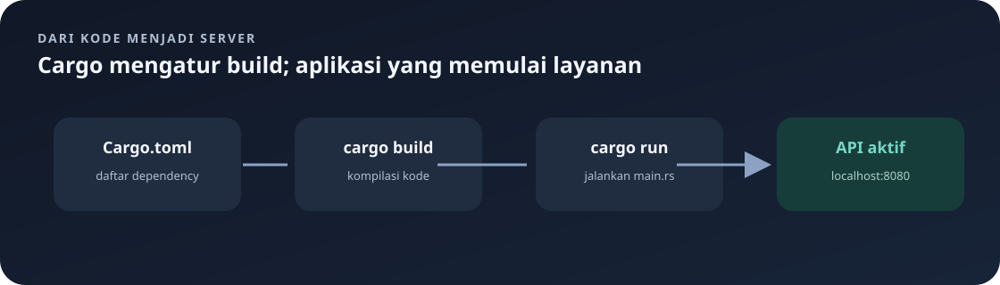

# `Cargo.toml`

Manifest Cargo menjelaskan identitas package Rust dan dependency yang diperlukan untuk membangun aplikasi.

Navigasi: [indeks](README.md) · [konfigurasi](env.md) · [startup](main.md).

> **Inti bab:** `Cargo.toml` adalah daftar pustaka dan fiturnya. Cargo memakai daftar ini untuk membangun backend.

File sumber: [Cargo.toml](../Cargo.toml).

## `[package]`

| Kunci | Nilai | Definisi |
|---|---|---|
| `name` | `restoran_api` | Nama package dan executable. |
| `version` | `0.1.0` | Versi package, menggunakan pola versi semantik. |
| `edition` | `2021` | Edisi aturan bahasa Rust, bukan nomor versi compiler. |

## `[dependencies]`

| Crate | Versi/fitur | Kegunaan |
|---|---|---|
| `actix-web` | `4` | Server HTTP, routing, ekstraksi request, dan response. |
| `dotenvy` | `0.15` | Membaca konfigurasi `.env`. |
| `serde` | `1`, fitur `derive` | Serialisasi/deserialisasi; derive membuat implementasi `Serialize` dan `Deserialize`. |
| `serde_json` | `1` | Membuat JSON dan macro `json!`. |
| `rust_decimal` | `1`, fitur `serde` | Angka desimal presisi untuk harga dan dukungan Serde. |
| `sqlx` | `0.8` | Query asynchronous ke database; fitur dijelaskan di bawah. |
| `actix-session` | `0.10`, fitur `cookie-session` | Mengelola session yang disimpan dalam cookie. |

Fitur SQLx:

- `runtime-tokio-rustls`: runtime Tokio dan transport TLS Rustls.
- `postgres`: driver PostgreSQL.
- `chrono`: dukungan tipe tanggal/waktu Chrono; aktif dalam manifest, meskipun tidak dipakai langsung oleh kode `src` saat ini.
- `rust_decimal`: konversi SQLx untuk tipe `Decimal`.

Fitur `cookie-session` menyediakan penyimpanan session berbasis cookie. Session menyimpan `user_id`, bukan password.

`Cargo.toml` menyatakan versi yang diizinkan; `Cargo.lock` menyimpan versi dependency konkret hasil resolusi supaya build konsisten.

Perintah berguna: `cargo check` memeriksa kompilasi, `cargo test` menjalankan tes, dan `cargo run` menjalankan aplikasi. `cargo check` tidak membuka koneksi database sehingga tidak membuktikan konfigurasi `.env` sudah benar.

### Pilih perintah sesuai kebutuhan

| Tujuan | Perintah | Yang dilakukan |
|---|---|---|
| Memeriksa apakah kode dapat dikompilasi | `cargo check` | Memeriksa tipe dan kompilasi tanpa menjalankan server. |
| Menjalankan tes | `cargo test` | Mengompilasi konfigurasi test dan menjalankan fungsi bertanda `#[test]`. |
| Menjalankan API | `cargo run` | Membangun lalu memulai server; perlu konfigurasi dan PostgreSQL yang siap. |

Jalankan perintah dari folder backend yang berisi `Cargo.toml`. Saat `cargo run` gagal sebelum server hidup, baca pesan terminal terlebih dahulu: bisa jadi variabel wajib belum tersedia atau koneksi PostgreSQL gagal.

## Cara Membaca Sintaks TOML

- `[package]` dan `[dependencies]` adalah table TOML. Kunci setelahnya menjadi properti di table tersebut sampai table baru dimulai.
- `name = "restoran_api"` adalah pasangan key-value. Teks ditulis dalam tanda kutip; angka versi di package ditulis sebagai teks karena mengikuti format versi.
- `{ version = "1", features = ["derive"] }` adalah inline table: beberapa konfigurasi untuk satu dependency ditulis dalam satu nilai.
- `features = [ ... ]` adalah array TOML. Setiap string mengaktifkan bagian tertentu dari crate dependency.
- Pada file ini, `serde` dan `rust_decimal` ditulis sebagai inline table karena masing-masing memakai fitur. `actix-web`, `dotenvy`, dan `serde_json` hanya menyatakan versi.
- `sqlx` memakai inline table multi-baris karena daftarnya lebih panjang. Pemisahan baris hanya untuk keterbacaan; secara makna tetap satu konfigurasi dependency.

## Makna Penulisan Versi

Versi dependency seperti `"4"`, `"1"`, dan `"0.8"` diproses Cargo sebagai persyaratan versi, umumnya dengan aturan kompatibilitas caret. Artinya Cargo boleh memilih versi patch/minor yang masih memenuhi aturan kompatibilitas, bukan selalu tepat versi tunggal itu. Versi yang benar-benar dipilih direkam di `Cargo.lock`.

Versi package sendiri (`0.1.0`) adalah metadata proyek dan tidak sama dengan versi compiler atau versi Actix. Pola semantik umumnya ditulis `MAJOR.MINOR.PATCH`.

## Mengapa Fitur Harus Diaktifkan?

Banyak crate memiliki bagian opsional agar binary tidak membawa semua integrasi yang mungkin. SQLx, misalnya, membutuhkan driver database dan runtime asynchronous yang sesuai. Fitur `postgres` mengaktifkan dukungan PostgreSQL; `runtime-tokio-rustls` memilih integrasi runtime dan TLS; `rust_decimal` menambahkan konversi tipe uang.

Fitur `chrono` aktif pada konfigurasi SQLx ini meskipun tidak ada kode `src` yang mengimpor tipe Chrono saat ini. Berarti fitur tersebut tersedia bagi crate, tetapi dapat jadi konfigurasi yang belum diperlukan oleh implementasi sekarang. Dokumentasi ini mencatat keadaan manifest, tidak menyimpulkan bahwa fitur harus dihapus.

## Bedanya Dependency Langsung dan Transitif

Crate pada `[dependencies]` adalah dependency langsung yang dapat dipakai kode proyek. Crate lain yang dibutuhkan oleh dependency tersebut dapat ikut diunduh sebagai dependency transitif dan tercatat dalam `Cargo.lock`, meski tidak ditulis satu per satu di `Cargo.toml`.

---

Kembali ke [indeks catatan](README.md) atau lanjut ke [startup aplikasi](main.md).
