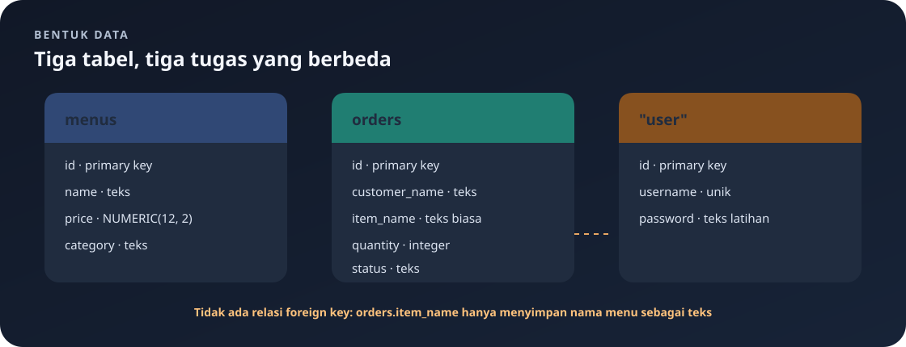

# `src/db.rs`

File ini menyiapkan tabel PostgreSQL saat aplikasi mulai.

Navigasi: [indeks](README.md) · [startup](main.md) · [model data](models.md) · [handler menu](handlers/menus.md) · [handler pesanan](handlers/orders.md).

> **Inti bab:** PostgreSQL menyimpan menu, pesanan, dan akun. Fungsi inisialisasi memastikan tabel ada, tetapi bukan sistem migrasi skema lengkap.

File sumber: [db.rs](../src/db.rs).

## Peta Relasi Data



`PK` berarti primary key, yaitu identitas unik row. Tabel `orders` saat ini **tidak memiliki foreign key** ke `menus`: `item_name` hanyalah teks yang disimpan pada pesanan. Karena itu, mengganti atau menghapus nama menu tidak otomatis mengubah pesanan lama.

## Import dan Fungsi

`use sqlx::PgPool;` mengimpor pool koneksi. `pub async fn initialize_database(pool: &PgPool) -> Result<(), sqlx::Error>` adalah fungsi publik asynchronous yang menerima referensi pool. `Ok(())` berarti semua query berhasil; `sqlx::Error` mewakili kegagalan database. Operator `?` meneruskan error pertama.

## Tabel `menus`

`CREATE TABLE IF NOT EXISTS` membuat tabel jika belum ada.

| Kolom | Definisi | Arti |
|---|---|---|
| `id` | `SERIAL PRIMARY KEY` | Nomor integer otomatis dan unik. |
| `name` | `TEXT NOT NULL` | Nama menu, wajib bukan `NULL`. |
| `price` | `NUMERIC(12, 2) NOT NULL` | Harga desimal hingga 12 digit total dan skala 2. |
| `category` | `TEXT NOT NULL` | Kategori, wajib bukan `NULL`. |

## Tabel `orders`

| Kolom | Definisi | Arti |
|---|---|---|
| `id` | `SERIAL PRIMARY KEY` | Nomor pesanan otomatis dan unik. |
| `customer_name` | `TEXT NOT NULL` | Nama pelanggan. |
| `item_name` | `TEXT NOT NULL` | Nama item pesanan sebagai teks. |
| `quantity` | `INT NOT NULL` | Banyaknya item. |
| `status` | `TEXT NOT NULL` | Status pesanan. |

`NOT NULL` melarang nilai SQL `NULL`, tetapi tidak dengan sendirinya melarang teks kosong atau angka nol.

## Tabel `"user"`

Tabel akun dipakai oleh handler autentikasi. Nama tabel ditulis dengan tanda kutip ganda di SQL karena `user` adalah kata khusus PostgreSQL. Di Rust, query memakai raw string, misalnya `r#"SELECT ... FROM "user""#`, agar tanda kutip SQL dapat ditulis langsung.

| Kolom | Definisi | Arti |
|---|---|---|
| `id` | `SERIAL PRIMARY KEY` | Nomor akun otomatis dan unik. |
| `username` | `TEXT NOT NULL UNIQUE` | Nama login wajib dan tidak boleh kembar. |
| `password` | `TEXT NOT NULL` | Password akun dalam bentuk teks biasa untuk latihan ini. |

Untuk database lama, `initialize_database` menjalankan `ALTER TABLE` yang menambahkan kolom `password` bila belum ada. Pada perintah migrasi ini kolom ditambahkan sebagai `TEXT` tanpa constraint `NOT NULL`; tabel akun yang baru dibuat memakai definisi `password TEXT NOT NULL`. Perintah ini tidak mengonversi kolom `password_hash` menjadi password; hash memang tidak dapat dibalik menjadi password asli. Struktur akun lama mungkin perlu diperiksa dan disesuaikan sebelum login dapat digunakan. Skema baru menyimpan password sebagai teks biasa, yang tidak aman dan hanya boleh dipakai untuk latihan lokal.

## Urutan Query

Ketiga perintah `CREATE TABLE` disimpan dalam array `statements`, kemudian perulangan menjalankan masing-masing dengan `sqlx::query(statement).execute(pool).await?`.

Perintah `ALTER TABLE menus ALTER COLUMN price TYPE NUMERIC(12, 2) USING price::NUMERIC(12, 2)` memastikan tipe harga dan mengonversi nilai lama dengan cast PostgreSQL. Perintah dijalankan saat setiap startup; kegagalan konversi mengembalikan error. Fungsi ini dipanggil dari `main.rs` sebelum HTTP server berjalan.

## Mengurai Signature dan Nilai Hasil

```rust
pub async fn initialize_database(pool: &PgPool) -> Result<(), sqlx::Error>
```

- `pub`: dapat dipanggil dari luar modul `db`, seperti `main.rs`.
- `async`: badan fungsi menghasilkan future; pemanggil perlu menunggu hasil dengan `.await`.
- `pool: &PgPool`: parameter bernama `pool` bertipe referensi immutable ke pool. Tanda `&` meminjam pool; fungsi ini tidak mengambil kepemilikan pool.
- `Result<(), sqlx::Error>`: jika sukses, tidak ada data penting untuk dikembalikan, sehingga tipe suksesnya `()` (unit). Jika gagal, isinya `sqlx::Error`.

`Result<T, E>` adalah enum yang secara konsep memiliki `Ok(T)` atau `Err(E)`. Pada fungsi ini hasilnya `Ok(())` atau `Err(sqlx::Error)`.

## Array dan Perulangan

`let statements = ["...", "...", "..."];` membuat array string literal dengan tiga elemen yang diketahui saat kompilasi. Tanda `let` mengikat nama `statements` ke nilai tersebut. Karena tidak ditulis `mut`, binding tidak dapat diganti.

```rust
for statement in statements {
	sqlx::query(statement).execute(pool).await?;
}
```

`for ... in ...` mengambil tiap elemen array satu per satu. Pada setiap putaran, nama `statement` menunjuk ke SQL yang sedang dijalankan. Perintah tersebut tidak mengembalikan row data, sehingga digunakan `execute`, bukan `fetch_all`.

## Membaca Rangkaian SQLx

`sqlx::query(statement)` membuat query dari string SQL. `.execute(pool)` mengirimkannya menggunakan pool dan menghasilkan hasil operasi atau error. `.await` menunggu operasi database selesai. `?` kemudian:

- mengambil nilai sukses sehingga hasil query dapat diabaikan pada statement ini; atau
- jika hasilnya `Err`, langsung mengembalikan error dari `initialize_database`.

Karena ada `?`, fungsi berhenti pada error pertama. Query berikutnya tidak dijalankan setelah kegagalan tersebut.

Pola sama digunakan pada `ALTER TABLE`: pemanggilan `.execute(pool).await?;` menunggu dan meneruskan error. Setelah semua perintah berhasil, `Ok(())` menyatakan fungsi sukses.

## Membaca SQL Tipe Harga

- `ALTER TABLE menus`: mengubah definisi tabel yang sudah ada.
- `ALTER COLUMN price TYPE NUMERIC(12, 2)`: mengubah tipe kolom `price` ke desimal presisi tetap.
- `USING ...`: memberi ekspresi untuk mengonversi nilai lama ketika PostgreSQL mengubah tipe kolom.
- `price::NUMERIC(12, 2)`: operator `::` adalah cast PostgreSQL; nilainya dikonversi ke `NUMERIC(12, 2)`.
- Batas `NUMERIC(12, 2)` berarti paling banyak 12 digit signifikan menurut definisi precision, dengan 2 digit setelah tanda desimal. Nilai yang tidak muat dapat menyebabkan error.

## Ruang Lingkup Fungsi

Fungsi ini hanya menyiapkan tabel dan tipe kolom. Ia tidak memasukkan data awal, tidak membuat foreign key antara `orders.item_name` dan `menus`, dan tidak membuat constraint agar harga/quantity positif. Pemeriksaan positif ada pada handler, sedangkan nilai contoh/data awal tidak dibuat di sini. Walaupun `CREATE TABLE IF NOT EXISTS` aman dipanggil berulang, perubahan definisi tabel yang telah ada tidak otomatis diterapkan kecuali ada perintah `ALTER TABLE` khusus seperti yang digunakan untuk kolom harga dan password.

---

Kembali ke [indeks catatan](README.md) atau lanjut ke [model data](models.md).
