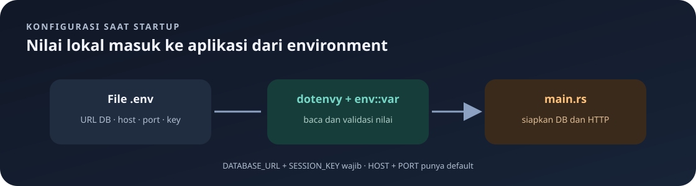

# Konfigurasi `.env`

File `.env` menyimpan pengaturan lokal dalam format `NAMA=nilai`. `main.rs` mencoba memuatnya dengan `dotenvy::dotenv()` saat aplikasi dimulai.

Navigasi: [indeks](README.md) · [dependency](cargo.md) · [urutan startup](main.md).

> **Inti bab:** `.env` memberi aplikasi nilai konfigurasi lokal. `DATABASE_URL` dan `SESSION_KEY` wajib; `HOST` dan `PORT` punya nilai default.

> Jangan masukkan nilai rahasia seperti password atau URL database nyata ke laporan, screenshot, atau repositori publik. Halaman ini hanya mendokumentasikan nama variabel.

## Variabel



| Variabel | Wajib | Default | Fungsi |
|---|---|---|---|
| `DATABASE_URL` | Ya | Tidak ada | URL koneksi PostgreSQL untuk SQLx. Biasanya berisi kredensial, host, port, dan nama database; rahasiakan nilainya. |
| `HOST` | Tidak | `127.0.0.1` | Alamat jaringan untuk server HTTP. `127.0.0.1` berarti hanya menerima koneksi lokal. |
| `PORT` | Tidak | `8080` | Port HTTP. Harus angka yang dapat diubah ke `u16`. |
| `SESSION_KEY` | Ya | Tidak ada | Kunci 64 byte untuk melindungi cookie session. Jangan dibagikan atau disimpan di Git. |

Contoh aman sebagai pola, bukan nilai siap pakai:

```dotenv
DATABASE_URL=<URL-PostgreSQL-lokal-anda>
HOST=127.0.0.1
PORT=8080
SESSION_KEY=<64-karakter-acak>
```

Di Linux/macOS, buat nilai acak dengan `openssl rand -hex 32`. Perintah itu menghasilkan 32 byte dalam bentuk 64 karakter heksadesimal. Kode membaca hasil tersebut sebagai 64 byte. Placeholder di atas bukan nilai siap pakai.

Simpan konfigurasi itu pada file bernama `.env` di folder backend, sejajar dengan `Cargo.toml`. Ganti semua placeholder dengan nilai lokal yang benar; teks dalam tanda `<...>` di atas hanya penanda dan tidak dapat dipakai sebagai URL koneksi.

## Cara Kode Menggunakannya

- `dotenvy::dotenv().ok()` mencoba membaca file; `.ok()` mengabaikan kegagalan membaca.
- `env::var("DATABASE_URL").expect(...)` tetap mewajibkan variabel tersebut. Jika hilang, startup berhenti.
- `HOST` dan `PORT` dibaca dengan `unwrap_or_else`, sehingga ada nilai default.
- `SESSION_KEY` wajib tersedia dan harus tepat 64 byte. Jika tidak ada atau panjangnya salah, startup berhenti.
- Port di-parse sebagai `u16`; teks nonangka atau angka di luar rentangnya membuat startup gagal.
- URL DB dipakai oleh `PgPoolOptions::connect`; host dan port dipakai oleh `HttpServer::bind`; key dipakai oleh `SessionMiddleware`.

Jika koneksi gagal, periksa apakah PostgreSQL hidup dan URL benar. Jika port sudah dipakai, pilih port lain.

Kode terkait: [main.rs](../src/main.rs).

## Arti `unwrap_or_else` pada Konfigurasi

Di `main.rs` terdapat pola seperti:

```rust
env::var("HOST").unwrap_or_else(|_| "127.0.0.1".to_string())
```

`env::var` mengembalikan `Result<String, VarError>`. Jika environment berisi teks Unicode yang valid, hasilnya `Ok(String)` dan string tersebut dipakai. Jika variabel tidak ada **atau** nilainya tidak dapat dibaca sebagai Unicode, hasilnya `Err(VarError)` dan `unwrap_or_else` menjalankan closure yang diberikan.

Closure `|_| ...` adalah fungsi kecil tanpa nama. Parameter `_` menerima nilai error tetapi mengabaikannya. Closure mengembalikan `String` default, sebab nilai `Ok` dari `env::var` juga bertipe `String`. Method ini membuat fallback tanpa menghentikan aplikasi. Sebaliknya, `expect(...)` akan panic saat hasilnya `Err`.

Secara tipe, `unwrap_or_else` pada `Result<T, E>` menerima closure yang diberi error `E` dan harus menghasilkan nilai `T`. Dalam contoh ini `T` adalah `String`, sementara `E` adalah `VarError`. `_` hanya menyembunyikan nama parameter; bentuk yang sama dengan nama lengkap kira-kira `|error| { let _ = error; "127.0.0.1".to_string() }`.

`unwrap_or_else` tidak membaca file `.env` sendiri; ia hanya menangani hasil `env::var`. Pemanggilan `dotenvy::dotenv()` sebelumnya mencoba mengisi environment dari file, lalu `env::var` membaca environment gabungan tersebut.

## Urutan Evaluasi Startup

1. Coba muat `.env` ke environment proses.
2. Ambil `DATABASE_URL` dan hentikan startup jika tidak tersedia.
3. Ambil `HOST`; jika tidak tersedia gunakan `127.0.0.1`.
4. Ambil `PORT`; jika tidak tersedia gunakan teks `8080`.
5. Parse teks port menjadi `u16`; teks tidak valid menyebabkan `expect` menghentikan startup.
6. Buat pool PostgreSQL dan siapkan tabel.
7. Ambil `SESSION_KEY` dan periksa panjangnya.
8. Gunakan host/port untuk menjalankan server dan key untuk melindungi session cookie.

Kode saat ini memakai `.cookie_secure(false)` agar cookie dapat digunakan melalui HTTP lokal. Untuk deployment HTTPS, ubah menjadi `true`. Jangan kirim cookie session melalui HTTP publik.

Perlu dibedakan: field `.env` adalah teks. Konversi `PORT` ke bilangan terjadi di Rust, bukan saat file dotenv dibaca.

---

Kembali ke [indeks catatan](README.md) atau lanjut ke [dependensi Cargo](cargo.md).
