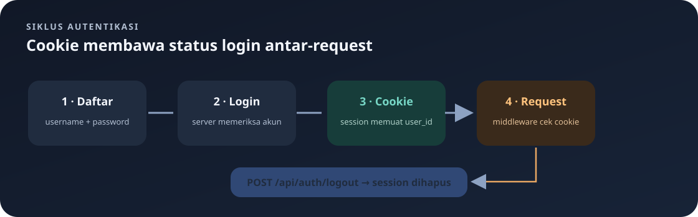

# `src/handlers/auth.rs`

File ini menangani pembuatan akun, login, logout, dan pemeriksaan akun yang sedang login. Handler menerima request HTTP, berinteraksi dengan tabel `"user"`, lalu mengirim response JSON.

Navigasi: [indeks catatan belajar](../README.md).

> **Inti bab:** login menaruh `user_id` ke session; client menyimpan cookie itu dan mengirimkannya kembali untuk membuktikan status login.

File sumber: [auth.rs](../../src/handlers/auth.rs).

## Konsep Singkat

- **Register** membuat akun baru dan menyimpan password di database.
- **Login** mencari username, membandingkan password, lalu menaruh `user_id` pada session.
- **Session cookie** adalah cookie yang dikirim server ke client. Browser atau Postman perlu menyimpannya dan mengirimkannya kembali pada request berikutnya.
- **Logout** menghapus isi session.
- Untuk latihan ini, password disimpan sebagai teks biasa agar alur dasarnya mudah dipahami. Cara ini tidak aman dan tidak boleh dipakai untuk aplikasi nyata.

### Siklus session



```text
POST /login → server memeriksa akun → session menyimpan user_id → client menerima cookie
     → client mengirim cookie pada request selanjutnya → middleware memeriksa session
     → POST /logout menghapus session
```

Cookie perlu disimpan oleh browser atau client HTTP. Menyalin body `{"message":"Login berhasil"}` saja tidak cukup untuk mengautentikasi request berikutnya.

## Import dan `Credentials`

`Session` menyediakan akses ke session cookie. `web::Json` membaca body JSON, `HttpResponse` membuat response, dan `error` mengubah kegagalan internal menjadi error Actix. `Deserialize` membuat JSON dapat diubah menjadi struct.

```rust
#[derive(Deserialize)]
pub struct Credentials {
    pub username: String,
    pub password: String,
}
```

`Credentials` adalah bentuk body yang dipakai register dan login. Karena tidak derive `Serialize`, struct ini tidak dimaksudkan untuk dikirim balik sebagai JSON. Pada latihan ini field `password` disimpan apa adanya di kolom database `password`.

Contoh body:

```json
{
  "username": "yofan",
  "password": "password-yang-kuat"
}
```

## `register`

Endpoint: `POST /api/auth/register`. Endpoint ini terbuka dan tidak memerlukan session.

1. `body.username.trim()` menghapus spasi di awal dan akhir username untuk pemeriksaan serta penyimpanan.
2. Username kosong atau password dengan panjang kurang dari 8 byte menghasilkan `400 Bad Request`. Pemeriksaan `String::len()` di Rust menghitung byte UTF-8, bukan jumlah karakter yang terlihat. Karena itu, delapan huruf ASCII tepat memenuhi batas, sedangkan karakter Unicode tertentu dapat memakai lebih dari satu byte.
3. Query `INSERT` menulis username dan password ke tabel PostgreSQL `"user"`. Tanda kutip ganda penting karena `user` adalah kata khusus PostgreSQL. Raw string `r#"..."#` memungkinkan tanda kutip SQL ditulis dalam string Rust.
4. `.bind(username)` dan `.bind(&body.password)` mengisi `$1` dan `$2` secara terpisah dari teks SQL.
5. Jika berhasil, response `201 Created`. Jika username sudah dipakai, constraint `UNIQUE` PostgreSQL dikenali dan handler mengembalikan `409 Conflict`. Error lain menjadi `500`.

Password tidak dikirim kembali di response, tetapi tersimpan sebagai teks biasa di database. Gunakan hanya password contoh untuk latihan lokal.

## `login`

Endpoint: `POST /api/auth/login`. Endpoint terbuka karena pengguna belum mempunyai cookie login.

1. Query mencari `id` dan `password` untuk username yang dikirim.
2. `fetch_optional` menghasilkan `Some((id, password))` jika ditemukan atau `None` jika username tidak ada.
3. Username yang tidak ditemukan menghasilkan `401 Unauthorized` dengan pesan umum. Pesan yang sama dipakai untuk password salah agar response tidak membocorkan apakah username terdaftar.
4. `body.password != stored_password` membandingkan password dari request dengan teks yang tersimpan.
5. Jika tidak sama, response `401`.
6. Jika sama, `session.insert("user_id", user_id)` menyimpan ID akun di session. `SessionMiddleware` mengubah session itu menjadi cookie pada response.
7. Response sukses hanya berisi pesan login, bukan password.

## `logout`

Endpoint: `POST /api/auth/logout`. Fungsi memanggil `session.purge()` untuk menghapus seluruh isi session. Cookie session berikutnya tidak lagi mengandung login aktif. Fungsi mengembalikan `200 OK` dan pesan berhasil.

Di `routes.rs`, logout tidak ditempatkan di scope yang memerlukan `require_login`. Karena itu ia dapat dipanggil meskipun client tidak memiliki session; pada keadaan tersebut tidak ada sesi aktif yang perlu dihapus.

## `me`

Endpoint: `GET /api/auth/me`. Route ini dilindungi middleware login, dan handler juga membaca session untuk mendapatkan `user_id`.

1. `session.get::<i32>("user_id")` membaca ID dari session. `?` meneruskan error pembacaan sebagai error server.
2. Jika tidak ada ID, handler mengembalikan `401`.
3. Query mengambil username berdasarkan ID dari tabel `"user"`.
4. Jika akun masih ada, response `200` berisi `id` dan `username`.
5. Jika akun tidak ditemukan lagi, session di-purge dan response `401` diberikan. Ini mencegah session yang merujuk akun terhapus tetap dianggap aktif.

## Membaca Tipe dan Hasil

Contoh signature register:

```rust
pub async fn register(
    state: web::Data<AppState>,
    body: web::Json<Credentials>,
) -> Result<HttpResponse, actix_web::Error>
```

- `web::Data<AppState>` memberi handler akses ke pool database.
- `web::Json<Credentials>` meminta Actix membaca JSON dan mengubahnya menjadi `Credentials`.
- `Result<HttpResponse, actix_web::Error>` berarti fungsi dapat menghasilkan response normal (`Ok`) atau error framework (`Err`).
- `?` setelah operasi SQL atau session mengembalikan error lebih awal bila operasi gagal.
- `HttpResponse::Created().json(...)` memilih status 201 dan mengubah data menjadi JSON.

## Mengapa Query Menulis `"user"`?

Di PostgreSQL, `user` memiliki arti khusus. Bila nama tabel benar-benar `user`, tulis sebagai identifier yang dikutip: `"user"`. Dalam Rust, contoh query ditulis seperti ini:

```rust
r#"SELECT id, password FROM "user" WHERE username = $1"#
```

Raw string Rust dimulai `r#"` dan berakhir `"#`; tanda kutip di dalamnya menjadi teks biasa. Nama tabel dan nama kolom harus sama dengan skema di `db.rs`: `"user"`, `id`, `username`, dan `password`.

## Kesalahan yang Umum

- **`syntax error at or near "user"`**: tabel ditulis `user` tanpa tanda kutip ganda di SQL.
- **`column "password" does not exist`**: pastikan startup terbaru sudah menambahkan kolom `password`.
- **Akun lama tidak bisa login**: password hash lama tidak dapat dikembalikan menjadi plaintext. Untuk latihan lokal, hapus akun lama lalu register ulang, atau gunakan username baru.
- **Endpoint menu/pesanan memberi 401 setelah login**: pastikan client menyimpan dan mengirim cookie dari response login.
- **Session tidak dapat dibuat saat startup**: `SESSION_KEY` harus tersedia dan cocok dengan panjang yang diminta `main.rs`.

## Catatan Keamanan

Password plaintext dapat dibaca siapa pun yang memiliki akses ke database. Jangan gunakan password sungguhan, jangan deploy versi ini ke production, dan jangan mencatat password, session cookie, atau `SESSION_KEY` ke log. Endpoint register saat ini terbuka untuk siapa saja yang dapat mengakses server. Batas 8 byte adalah validasi sederhana, bukan pengukuran kualitas password.
