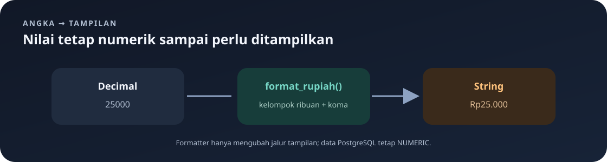

# `src/handlers/format.rs`

File ini menyediakan fungsi untuk mengubah harga bertipe `Decimal` menjadi teks yang mudah dibaca dengan format Rupiah.

Navigasi: [indeks](../README.md) · [handler menu](menus.md) · [model data](../models.md).

> **Inti bab:** harga tetap angka Decimal saat disimpan dan dihitung; fungsi ini hanya mengubahnya menjadi teks Rupiah untuk tampilan.

File sumber: [format.rs](../../src/handlers/format.rs).

## Tujuan dan Pemakaian



Nilai uang disimpan sebagai angka desimal, bukan sebagai teks berformat. Saat response API perlu menampilkan harga, handler menu memanggil `format_rupiah`. Dengan pemisahan ini, query dan perhitungan tetap memakai angka, sementara aturan tampilan berada di satu fungsi.

Contoh hasil:

| Nilai `Decimal` | Teks hasil |
|---:|---|
| `25000` | `Rp25.000` |
| `1250.5` | `Rp1.250,5` |

Cara membaca hasil: titik memisahkan kelompok ribuan dan koma memisahkan pecahan. Fungsi mempertahankan digit pecahan yang tersisa setelah `Decimal::normalize()`, sehingga `1250.50` ditampilkan sebagai `Rp1.250,5`, bukan selalu dua angka desimal.

## Fungsi `format_rupiah`

```rust
pub fn format_rupiah(price: Decimal) -> String
```

- `pub` membuat fungsi dapat dipakai dari modul lain.
- `price: Decimal` menerima angka desimal dari crate `rust_decimal`.
- `-> String` berarti fungsi mengembalikan teks yang dimiliki sendiri, bukan sekadar pinjaman ke data input.

Langkah kerjanya:

1. `price.normalize().to_string()` menormalkan representasi desimal lalu mengubahnya menjadi teks. Nol pecahan yang tidak diperlukan dapat dihilangkan.
2. `split_once('.')` memisahkan bagian bilangan bulat dan pecahan. Jika tidak ada titik desimal, `unwrap_or((&value, ""))` memakai seluruh nilai sebagai bagian integer dan string kosong sebagai bagian pecahan.
3. `integer.chars().rev().enumerate()` membaca digit integer dari kanan ke kiri sambil memberi indeks mulai dari nol.
4. Kondisi `index > 0 && index % 3 == 0` menambahkan titik sebelum digit berikutnya setiap melewati kelompok tiga digit. Operator `%` menghasilkan sisa pembagian.
5. Hasil yang dibangun dari kanan ke kiri dibalik lagi dengan `.chars().rev().collect()`.
6. Jika pecahan kosong, fungsi mengembalikan `Rp` dan integer berkelompok. Jika ada pecahan, fungsi menambahkan koma lalu digit pecahannya.

Contoh pemformatan menggunakan titik sebagai pemisah ribuan dan koma sebagai pemisah desimal, sesuai kebiasaan penulisan angka di Indonesia. Fungsi ini hanya mengubah teks response; fungsi ini tidak mengubah angka di PostgreSQL.

## Sintaks yang Digunakan

- `use rust_decimal::Decimal;` mengimpor tipe `Decimal` dari crate `rust_decimal`. Tanda `::` memisahkan crate atau modul dari item di dalamnya.
- `let value = ...;` membuat binding bernama `value`. Tanpa `mut`, binding itu tidak dapat diberi nilai baru.
- `String::new()` membuat string kosong yang dapat ditambahi karakter.
- `for (index, digit) in ...` mengulang pasangan indeks dan karakter. Pola dalam kurung membongkar tuple menjadi dua nama lokal.
- `push('.')` menambahkan satu karakter ke string.
- `format!(...)` membuat `String` dari teks dan nilai yang disisipkan pada placeholder.
- `if ... { ... } else { ... }` memilih ekspresi hasil berdasarkan kondisi. Kedua cabang di sini menghasilkan `String`.
- `normalize`, `to_string`, `split_once`, `chars`, `rev`, `enumerate`, dan `collect` adalah method/operasi iterator yang menyusun perubahan dari angka ke teks.

## Tes Unit

Modul tes memeriksa pemisah ribuan dan pecahan:

```rust
assert_eq!(format_rupiah(Decimal::new(2500000, 2)), "Rp25.000");
assert_eq!(format_rupiah(Decimal::new(125050, 2)), "Rp1.250,5");
```

`Decimal::new(mantissa, scale)` membentuk nilai dari integer dasar dan skala desimal. Contohnya `Decimal::new(125050, 2)` mewakili `1250.50`; normalisasi membuat tampilan pecahannya menjadi `,5`. `assert_eq!` menggagalkan tes bila hasil aktual berbeda dari hasil yang diharapkan.

Jalankan tes proyek dengan `cargo test`. Tes ini memeriksa kasus yang dicontohkan; fungsi saat ini mengasumsikan harga positif sebagaimana validasi handler menu, bukan menangani semua kemungkinan format angka negatif.

## Hubungan dengan Handler Menu

Modul `handlers/menus.rs` menggunakan formatter ketika mengambil harga untuk response daftar, detail, dan filter `field=price`. Struct `MenuItem` sendiri tetap menyimpan `price` sebagai `Decimal`; formatter membuat representasi teks hanya pada jalur response tertentu.

---

Kembali ke [indeks catatan](../README.md) atau lanjut ke [handler menu](menus.md).
