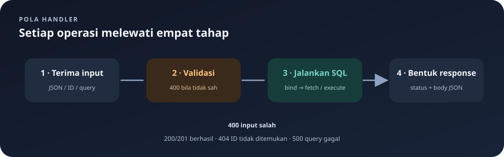

# `src/handlers/menus.rs`

File ini mengimplementasikan endpoint menu, validasi input, format harga, penanganan error DB, dan satu tes unit.

Navigasi: [indeks catatan belajar](../README.md) | [format harga](format.md).

> **Inti bab:** handler menu menerjemahkan request menjadi query menu, dan mengubah hasilnya menjadi response HTTP. Validasi ada sebelum query tulis.

File sumber: [menus.rs](../../src/handlers/menus.rs).

### Isi halaman

- [Daftar menu dan filter](#get_menus)
- [Baca satu menu](#get_menu)
- [Buat menu](#create_menu)
- [Ganti semua field](#update_menu)
- [Ubah sebagian field](#patch_menu)
- [Hapus menu](#delete_menu)
- [Validasi](#validate_menu)
- [Query, SQLx, dan response](#pola-query-sql-yang-dipakai-di-semua-handler)
- [Contoh request](#contoh-request-menu)

### Peta operasi



| Operasi | Input | Hasil sukses | Hal yang perlu diingat |
|---|---|---|---|
| GET daftar | Query opsional `field` | Array | Tanpa filter, urut ID naik; `price` diformat Rupiah. |
| GET satu | ID pada path | Array | ID tidak ada → `404`. |
| POST | `MenuInput` lengkap | Object, `201` | Nama/kategori tidak kosong; harga positif. |
| PUT | ID + `MenuInput` lengkap | Object, `200` | Mengganti semua field. |
| PATCH | ID + satu atau lebih field | Object, `200` | Field lain tetap; body `{}` ditolak. |
| DELETE | ID | Pesan, `200` | ID yang tidak ada → `404`. |

**Urutan membaca handler:** cari signature → lihat validasi → ikuti SQL dan urutan `.bind()` → periksa cabang hasil → lihat status dan JSON.

## Import

`web`, `HttpResponse`, `Responder` berasal dari Actix; `Decimal` menangani harga; `HashMap<String, String>` membaca query string; `MenuInput`, `MenuItem`, `MenuPatchInput` adalah model menu; `AppState` menyediakan pool di `state.db`.

## `get_menus`

Menangani `GET /api/menus`. Nilai query `field` menentukan hasil:

Semua endpoint dalam scope `/api/menus` memakai `require_login`. Request harus membawa session cookie yang valid sebelum fungsi dalam file ini dijalankan. Alur login dijelaskan di [handler autentikasi](auth.md).

- Tanpa field: `SELECT id, name, price, category ... ORDER BY id ASC`; tiap row menjadi array `[id, name, harga-terformat, category]`.
- `field=id`: hanya ID sebagai array angka.
- `field=name`: nama sebagai array string.
- `field=price`: harga sebagai array string Rupiah.
- `field=category`: kategori sebagai array string.
- Field lain: `400 Bad Request` dengan daftar field yang boleh.

Contoh daftar penuh:

```json
[
  [1, "Nasi Goreng", "Rp25.000", "Makanan"],
  [2, "Es Teh", "Rp5.000", "Minuman"]
]
```

Urutan elemen adalah `[id, name, price, category]`. Response ini berupa array posisi, bukan object bernama. Sebaliknya, create/update/patch mengirim object `MenuItem`; lihat contoh request dan response pada bagian akhir halaman.

`query_as` memetakan beberapa kolom ke tuple, sedangkan `query_scalar` mengambil satu kolom. Semua query daftar mengurutkan ID menaik. Query gagal ditangani oleh `database_error`.

## `get_menu`

Menangani `GET /api/menus/{id}`. Path diekstrak sebagai `i32`, dibind ke placeholder SQL `$1`, lalu `fetch_optional` mencari row. Ditemukan: `200` dan array `[id, name, harga Rupiah, category]`. Tidak ditemukan: `404` dan JSON error. Kegagalan query: `500`.

## `create_menu`

Menangani `POST /api/menus` dengan `MenuInput`. Memanggil `validate_menu` lebih dahulu. Jika valid, query `INSERT` membind nama, harga, kategori; `trim()` membuang whitespace di ujung teks. `RETURNING` mengambil row baru. Berhasil: `201 Created` dan objek `MenuItem`; gagal: `500`.

## `update_menu`

Menangani `PUT /api/menus/{id}` sebagai penggantian penuh. Semua field `MenuInput` wajib dan divalidasi. Query menetapkan tiga kolom dengan bind parameter dan ID. Hasil `fetch_optional`: ditemukan `200` dengan objek menu; tidak ditemukan `404`; error SQL `500`.

## `patch_menu`

Menangani `PATCH /api/menus/{id}` dengan field opsional.

1. Menolak body jika semua field `None`.
2. Nama dan kategori yang dikirim tidak boleh kosong setelah `trim()`.
3. Harga yang dikirim harus lebih besar dari `Decimal::ZERO`.
4. Query memakai `COALESCE(parameter, kolom)` agar nilai `NULL` mempertahankan nilai lama.
5. String opsional di-trim dengan `as_deref().map(str::trim)`; semua nilai dibind ke SQL.
6. `RETURNING` memberikan nilai terbaru: `200` jika ditemukan, `404` jika ID tidak ada, `500` jika database gagal.

## `delete_menu`

Menangani `DELETE /api/menus/{id}`. Menghapus berdasarkan ID terikat. `rows_affected() > 0` berarti berhasil (`200` dan pesan); nol berarti tidak ada menu (`404`); query gagal berarti `500`.

## `validate_menu`

Helper privat untuk input lengkap. Menghasilkan response `400` jika nama/kategori kosong setelah trim atau harga kurang dari/sama dengan nol. Mengembalikan `None` jika valid. Dipakai create dan PUT; PATCH memerlukan pemeriksaan khusus karena field-nya opsional.

## `format_rupiah`

Helper privat yang menormalkan `Decimal`, mengubahnya ke teks, lalu memisahkan bagian integer dan pecahan. Bagian integer dibaca terbalik dan diberi titik tiap tiga digit, lalu dibalik kembali. Bagian pecahan (jika ada) diawali koma. Contoh `25000` menjadi `Rp25.000`; `1250.5` menjadi `Rp1.250,5`. Ini format tampilan, bukan perubahan nilai database.

## `database_error`

Mencatat detail error SQLx dan pesan konteks memakai `eprintln!` (log server). Klien hanya menerima `500 Internal Server Error` dengan JSON yang memuat pesan konteks, bukan detail internal database.

## Tes

`#[cfg(test)]` hanya mengikutkan modul saat test. Tes `formats_rupiah_with_thousand_separators` memeriksa `Decimal::new(2500000, 2)` menjadi `Rp25.000` dan `Decimal::new(125050, 2)` menjadi `Rp1.250,5`. Argumen kedua `Decimal::new` adalah skala desimal.

<details>
<summary>🔎 Pendalaman: cara membaca sintaks Rust, Actix, dan SQLx</summary>

Bagian ini berguna setelah kamu memahami alur endpoint di atas. Jika baru belajar, kamu boleh melewatinya dulu dan kembali saat menemukan sintaks yang ingin dipahami.

## Membaca Tipe Parameter Handler

Contoh signature:

```rust
pub async fn get_menu(state: web::Data<AppState>, path: web::Path<i32>) -> impl Responder
```

- `pub` membuat fungsi bisa dipanggil dari `routes.rs`.
- `async fn` berarti handler dapat menunggu operasi SQLx dengan `.await`.
- `state: web::Data<AppState>` adalah state Actix yang berisi pool.
- `path: web::Path<i32>` adalah extractor Actix: framework mengambil segmen `{id}` dari URL lalu mengonversinya ke `i32`.
- `-> impl Responder` artinya fungsi mengembalikan suatu tipe konkret yang mengimplementasikan trait `Responder`. Kita tidak perlu menuliskan tipe response internal Actix secara eksplisit.
- `web::Json<MenuInput>` pada handler create/update mengekstrak JSON body dan mendeserialisasikannya menjadi `MenuInput`.
- `web::Query<HashMap<String, String>>` mengekstrak query string, misalnya `?field=price`, menjadi map dengan key dan value teks.

Jika framework tidak dapat mengurai path, query, atau JSON ke tipe tersebut, request dapat ditolak sebelum badan handler dijalankan.

## `get_menus`: `Option`, `match`, dan Hasil SQL

`query.get("field")` mengembalikan `Option<&String>`: key ada menghasilkan `Some(&String)`, tidak ada menghasilkan `None`. `.map(String::as_str)` mengubah nilai di dalam `Some` menjadi `&str`; jika asalnya `None`, hasilnya tetap `None`. Jadi `field` bertipe `Option<&str>`.

`match field { ... }` mencocokkan kedua kemungkinan `Option` dan nilainya:

- `None => { ... }` berarti query tidak menyertakan `field`.
- `Some("id") => ...` berarti nilai field tepat `id`.
- `Some(_) => ...` menangkap nilai lain apa pun; `_` adalah wildcard yang tidak menyimpan nilai.

Cabang tanpa field menggunakan `query_as::<_, (i32, String, Decimal, String)>`. `query_as` meminta SQLx memetakan kolom hasil ke target; `_` membiarkan compiler menyimpulkan tipe query internal, sementara tuple menyebut tipe tiap kolom secara urut. Urutan tuple harus sesuai urutan kolom SELECT.

`fetch_all(&state.db).await` menjalankan query dan mengambil semua row. Tipe hasilnya `Result<Vec<...>, sqlx::Error>`. `match` berikutnya memisahkan `Ok(rows)` dari `Err(error)`. `Ok` menyimpan hasil sukses; `Err` menyimpan error database.

Pada cabang sukses:

```rust
rows.into_iter()
	.map(|(id, name, price, category)| ...)
	.collect::<Vec<_>>()
```

- `into_iter()` mengonsumsi `rows` dan menghasilkan iterator atas tiap tuple; `rows` tidak dipakai lagi sesudahnya.
- `.map(...)` mengubah setiap elemen menjadi elemen baru. Closure `|(id, name, price, category)|` menerima tuple lalu melakukan destructuring: setiap bagian diberi nama lokal.
- `serde_json::json!([ ... ])` membuat nilai JSON array dengan urutan elemen yang ditulis.
- `collect::<Vec<_>>()` mengumpulkan hasil iterator menjadi `Vec`; `::<Vec<_>>` memberi tahu tipe koleksi tujuan, sedangkan `_` membuat compiler menyimpulkan tipe isi vector.
- `HttpResponse::Ok().json(values)` membuat response status 200 dan menserialisasi `values` sebagai JSON.

Cabang `Err(error)` memanggil helper dan mengembalikan response error, sehingga tiap cabang `match` menghasilkan tipe response yang dapat menjadi hasil handler.

Filter tunggal memakai `query_scalar::<_, i32>(...)` atau tipe lain. `query_scalar` cocok ketika SELECT hanya memilih satu kolom. Setelah `fetch_all`, hasil tetap `Result<Vec<T>, sqlx::Error>`. Untuk harga, `.into_iter().map(format_rupiah).collect::<Vec<_>>()` menerapkan fungsi `format_rupiah` pada setiap harga lalu mengumpulkan semua string.

## Pola Query SQL yang Dipakai di Semua Handler

- `let query = "...";` menyimpan teks SQL sebagai string slice `&str`.
- `$1`, `$2`, dan seterusnya adalah placeholder parameter PostgreSQL. Nilainya tidak ditempel ke teks query.
- `.bind(value)` memasangkan nilai dengan placeholder berikutnya. Urutan `.bind` harus sama dengan urutan placeholder dalam query.
- Penggunaan bind menghindari penyusunan SQL dari teks input, serta memungkinkan SQLx mengirim nilai dengan tipe yang sesuai.
- `&state.db` meminjam pool untuk operasi query; handler tidak mengambil kepemilikan pool.
- `.fetch_optional()` menghasilkan `Result<Option<Row>, Error>`: `Ok(Some(row))` ada row, `Ok(None)` query berhasil tetapi row tidak ditemukan, dan `Err(error)` query gagal.
- `.fetch_one()` mengambil satu row dan menghasilkan error SQLx jika tidak ada row. Jika query menghasilkan beberapa row, method ini mengambil satu row, bukan memvalidasi keunikan hasil. Dipakai setelah INSERT yang memakai `RETURNING`.
- `.fetch_all()` mengambil nol atau lebih row dalam `Vec`.
- `.execute()` menjalankan query tanpa memetakan row; hasilnya berisi metadata operasi seperti jumlah row terdampak.

## Membaca Cabang `match` GET Satu Menu

```rust
match hasil {
	Ok(Some(menu)) => ..., 
	Ok(None) => ..., 
	Err(error) => ...,
}
```

Ini adalah pencocokan bertingkat: lapisan luar `Result` memisahkan sukses/error; dalam hasil sukses ada `Option` yang memisahkan ditemukan/tidak ditemukan. `Some(menu)` juga mengikat nilai row ke nama `menu`, yang kemudian dapat dibaca sebagai `menu.id`, `menu.name`, dan seterusnya. Bentuk pola yang sama dipakai pada update dan patch.

## `create_menu` dan `update_menu`: Validasi Awal

```rust
if let Some(response) = validate_menu(&body) {
	return response;
}
```

`validate_menu` memberi `Option<HttpResponse>`. `if let Some(response)` hanya menjalankan blok bila ada response kesalahan. `return response` menghentikan fungsi lebih awal; jika hasilnya `None`, eksekusi lanjut ke query.

`&body` meminjam input agar helper dapat membacanya tanpa mengambil body dari handler. `body.name.trim()` meminjam teks tanpa whitespace tepi, bukan mengubah isi `String`; nilai hasil trim itulah yang dibind ke query.

`INSERT ... RETURNING ...` menyimpan row baru dan langsung meminta semua kolom hasil. `fetch_one` sesuai karena sukses INSERT yang valid diharapkan mengembalikan satu row. `UPDATE ... WHERE id = $4 RETURNING ...` dapat mengembalikan nol row bila ID tidak ada, sehingga memakai `fetch_optional`.

## `patch_menu`: Pemeriksaan `Option`

- `body.name.is_none()` memeriksa apakah field adalah `None`, tanpa mengambil isi field.
- Operator `&&` berarti AND (semua syarat harus benar); `||` berarti OR (cukup satu benar). Pemeriksaan pertama memakai `&&` untuk mendeteksi bahwa semua field tidak diberikan.
- `as_ref()` mengubah `&Option<String>` menjadi `Option<&String>` supaya nilai dapat diperiksa tanpa memindahkan String keluar dari body.
- `.is_some_and(|name| ...)` mengembalikan `true` hanya jika ada nilai dan closure menghasilkan `true`. Closure hanya dipanggil untuk `Some`; pada kode ini string diperiksa apakah kosong setelah trim.
- `is_some_and` mengonsumsi Option yang menjadi receiver. Pada `body.price`, `Option<Decimal>` dapat disalin karena `Decimal` bertipe `Copy`; pada nama/kategori dipakai `as_ref()` supaya String tidak dipindahkan.
- `Decimal::ZERO` adalah konstanta desimal nol.

Pada pengikatan PATCH, `.as_deref()` mengubah `Option<String>` menjadi `Option<&str>` dengan meminjam string. `.map(str::trim)` menjalankan `trim` hanya kalau nilainya `Some`; `None` tetap `None`. Nilai opsional inilah yang dibind, lalu SQL `COALESCE` memutuskan apakah memakai nilai baru atau nilai lama.

## `delete_menu`: `match` dengan Guard

`.execute(...).await` menghasilkan `Result<PgQueryResult, sqlx::Error>`. Pada pola:

```rust
Ok(result) if result.rows_affected() > 0 => ...,
Ok(_) => ...,
Err(error) => ...,
```

- `Ok(result)` menangkap hasil query sukses ke variabel `result`.
- `if result.rows_affected() > 0` adalah match guard, yaitu syarat tambahan agar arm pertama dipilih.
- `Ok(_)` menangkap hasil sukses yang tidak cocok dengan guard; di sini berarti tidak ada row terhapus.
- `Err(error)` menangkap kegagalan SQL.

## `validate_menu`: Reference dan Kondisi

Parameter `menu: &MenuInput` adalah pinjaman immutable; `&` mencegah helper mengambil ownership input. `Option<HttpResponse>` memungkinkan helper menyatakan “tidak ada error” dengan `None`, atau menyertakan response error dengan `Some(...)`.

`if A || B` memeriksa apakah nama atau kategori kosong. Jika ya, `return Some(...)` keluar dari helper saat itu juga. Pemeriksaan harga dilakukan setelahnya hanya jika pemeriksaan pertama lolos. Nilai terakhir `None` adalah hasil normal saat seluruh aturan lolos.

## `format_rupiah`: Iterasi Karakter

- `price.normalize()` menormalkan bentuk Decimal, misalnya membuang nol pecahan berlebih.
- `.to_string()` menghasilkan `String` untuk diproses sebagai teks.
- `.split_once('.')` menghasilkan `Option<(&str, &str)>`: bagian sebelum titik dan sesudah titik. `.unwrap_or((&value, ""))` memberi pasangan default jika titik desimal tidak ada.
- `integer.chars().rev()` menghasilkan karakter bagian integer dari kanan ke kiri.
- `.enumerate()` memasangkan tiap karakter dengan indeks mulai nol.
- `if index > 0 && index % 3 == 0` menyisipkan titik sebelum karakter pada batas kelompok ribuan. `%` adalah sisa bagi.
- `push` menambahkan karakter ke `String`.
- `reversed_grouped.chars().rev().collect()` membalik kembali karakter hasil pengelompokan dan mengumpulkannya sebagai `String`; tipe `String` ditulis eksplisit di binding `grouped`.
- `if fraction.is_empty()` memilih format tanpa pecahan atau dengan pecahan.
- `format!(...)` membangun string dengan interpolasi variabel.

Perlu diingat bahwa algoritma ini mengasumsikan bagian integer berisi digit biasa. Handler hanya menerima harga positif, sehingga tanda minus tidak menjadi kasus input yang diharapkan.

## Helper Error dan Tes

`database_error(message: &str, error: sqlx::Error)` meminjam pesan teks dan mengambil error SQLx secara ownership. `eprintln!` menulis ke standard error, biasanya masuk ke log proses. Response klien hanya memuat pesan umum.

`#[cfg(test)]` membuat modul aktif hanya saat `cargo test`. `use super::format_rupiah;` mengambil fungsi privat dari modul induk agar dapat diuji. `#[test]` menandai fungsi tes sinkron. `assert_eq!(aktual, harapan)` gagal dengan detail bila kedua nilai berbeda.

## Builder Response Actix dan Macro JSON

Ekspresi seperti `HttpResponse::BadRequest().json(serde_json::json!({ "error": "..." }))` dibaca dari dalam ke luar:

1. `serde_json::json!({ ... })` adalah macro yang membentuk object JSON. Nama key ditulis sebagai string, dan value dapat berasal dari ekspresi Rust.
2. `HttpResponse::BadRequest()` membuat builder response dengan status HTTP 400. Padanan yang dipakai file ini meliputi `Ok()` (200), `Created()` (201), `NotFound()` (404), dan `InternalServerError()` (500).
3. `.json(nilai)` mengubah builder menjadi response dengan body JSON dan content type yang sesuai.

`HttpResponse::Ok()` adalah pemanggilan associated function pada tipe `HttpResponse`, ditandai dengan `::`. Sebaliknya `.json(...)` adalah method pada nilai builder, ditandai titik.

Array JSON dibuat menggunakan `json!([nilai1, nilai2, ...])`; urutan tetap mengikuti urutan elemen. Itulah sebabnya GET menu menampilkan array berurutan, sementara create/update memakai `.json(menu)` dan menghasilkan object dari field struct yang diserialisasi.

`format!("Rp{grouped},{fraction}")` adalah macro pembentuk `String`, bukan macro JSON. `eprintln!("{message}: {error}")` menulis teks terformat ke standard error. Kedua macro menerima placeholder `{nama}` yang mengambil variabel bernama sama.

## Operasi String dan Urutan SQL

- `.trim()` menghasilkan slice teks tanpa whitespace di awal/akhir; tidak memodifikasi string asal.
- `.is_empty()` memeriksa apakah teks memiliki panjang nol. Karena validasi memanggil `trim()` lebih dulu, string berisi spasi saja juga dianggap kosong.
- `.split_once('.')` memisahkan teks pada titik pertama dan mengembalikan pasangan bila pemisah ditemukan.
- `.normalize()` adalah method `Decimal` untuk menormalkan skala representasi desimal.
- `.rows_affected()` membaca jumlah row yang terkena operasi SQL; DELETE memakai nilai ini untuk membedakan ID ada dan tidak ada.
- `ORDER BY id ASC` mengurutkan ID menaik; `ASC` berarti ascending. Pada tabel menu, ID kecil muncul lebih dahulu.
- `RETURNING kolom...` adalah fitur PostgreSQL untuk mengirim row yang baru di-insert atau di-update sebagai hasil query.

</details>

## Contoh Request Menu

Membuat menu mengirim body lengkap karena route memakai `MenuInput`:

```http
POST /api/menus
Content-Type: application/json

{
	"name": "Nasi Goreng",
	"price": 25000,
	"category": "Makanan"
}
```

Jika valid, server mengembalikan `201 Created` dengan object `MenuItem` hasil serialisasi, misalnya berisi `id`, `name`, `price`, dan `category`. ID tidak disediakan dalam request karena database membuatnya.

PATCH hanya perlu field yang ingin diganti:

```http
PATCH /api/menus/7
Content-Type: application/json

{
	"price": 27500
}
```

Field lain menjadi `None`, dibind sebagai SQL `NULL`, dan `COALESCE` mempertahankan nilai lama. Body `{}` ditolak karena tidak meminta perubahan apa pun. Harga `0` juga ditolak oleh validasi.

Untuk membaca kolom tertentu, contoh `GET /api/menus?field=name` mengembalikan array nama; `field` yang tidak dikenal menghasilkan 400. Untuk ID yang tidak ada pada GET/PUT/PATCH/DELETE satu menu, handler menghasilkan 404.
