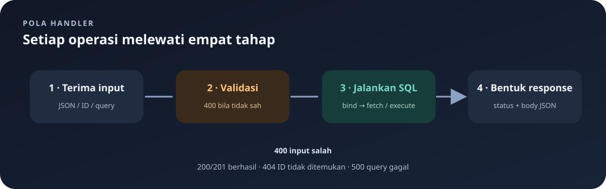

# `src/handlers/orders.rs`

File ini mengimplementasikan endpoint daftar/detail pesanan dan operasi create, replace, patch, delete beserta validasinya.

Navigasi: [indeks catatan belajar](../README.md) · [model data](../models.md) · [routing](../routes.md) · [handler autentikasi](auth.md).

> **Inti bab:** handler pesanan mengelola CRUD dan memastikan teks terisi serta jumlah lebih dari nol sebelum menyimpan perubahan.

File sumber: [orders.rs](../../src/handlers/orders.rs).

### Isi halaman

- [Daftar dan filter pesanan](#get_orders)
- [Baca satu pesanan](#get_order)
- [Buat pesanan](#create_order)
- [Ganti semua field](#update_order)
- [Ubah sebagian field](#patch_order)
- [Hapus pesanan](#delete_order)
- [Validasi input](#validate_order)
- [Cara kerja query dan fetch](#perbedaan-query_as-dan-query_scalar)
- [Contoh request](#contoh-request-pesanan)

### Peta operasi



| Operasi | Input | Hasil sukses | Hal yang perlu diingat |
|---|---|---|---|
| GET daftar | Query opsional `field` | Array | Urut ID turun; filter mengambil satu kolom. |
| GET satu | ID pada path | Array | ID tidak ada → `404`. |
| POST | `OrderInput` lengkap | Object, `201` | Quantity positif; teks wajib terisi. |
| PUT | ID + `OrderInput` lengkap | Object, `200` | Mengganti semua field. |
| PATCH | ID + satu atau lebih field | Object, `200` | Field lain tetap; body `{}` ditolak. |
| DELETE | ID | Pesan, `200` | ID yang tidak ada → `404`. |

**Urutan membaca handler:** kenali extractor request → ikuti validasi → cocokkan placeholder SQL dengan `.bind()` → lihat hasil `fetch_*` → baca status response.

## Import

Actix `web`, `HttpResponse`, `Responder` menangani request dan response. `HashMap<String, String>` membaca query parameter. `Order`, `OrderInput`, dan `OrderPatchInput` adalah model data. `AppState` memberi akses ke pool DB.

## `get_orders`

Menangani `GET /api/orders`. Tanpa parameter `field`, mengambil semua kolom dan mengurutkan `id DESC`, lalu mengubah tiap row menjadi array `[id, customer_name, item_name, quantity, status]`. Dengan field:

Semua endpoint dalam scope `/api/orders` memakai `require_login`. Request tanpa session valid ditolak sebelum fungsi handler berjalan. Lihat [handler autentikasi](auth.md) untuk alur login dan penggunaan cookie.

- `id`: array ID integer.
- `customer_name`: array nama pelanggan.
- `item_name`: array nama item.
- `quantity`: array jumlah integer.
- `status`: array status.
- Nilai lain: `400` beserta daftar field valid.

Daftar penuh memakai `query_as::<_, Order>`; filter satu kolom memakai `query_scalar` dengan tipe yang sesuai. Hasil field tunggal tetap dikemas sebagai JSON array. Error query ditangani helper error.

Contoh daftar penuh:

```json
[
  [12, "Ayu", "Nasi Goreng", 2, "menunggu"],
  [11, "Budi", "Es Teh", 1, "diproses"]
]
```

Setiap nilai pada row array mengikuti urutan kolom yang sudah disebutkan. Konsumen API perlu membaca posisi tersebut; response ini belum memakai nama field JSON.

## `get_order`

Menangani `GET /api/orders/{id}`. Mengikat ID ke `$1` dan mencari dengan `fetch_optional`. Ditemukan: `200` dan array `[id, customer_name, item_name, quantity, status]`; tidak ditemukan: `404`; gagal query: `500`.

## `create_order`

Menangani `POST /api/orders`. Membaca JSON sebagai `OrderInput`, menjalankan `validate_order`, lalu `INSERT` empat field. Tiga nilai teks di-trim. `RETURNING` mengambil row baru. Sukses `201 Created` dengan objek `Order`; kegagalan DB `500`.

## `update_order`

Menangani `PUT /api/orders/{id}` dan mengganti seluruh field yang dapat diedit. Input lengkap divalidasi; query menetapkan nama pelanggan, item, jumlah, status pada ID yang diberikan. Row ditemukan menghasilkan `200` dan objek; ID tidak ditemukan `404`; error SQL `500`.

## `patch_order`

Menangani `PATCH /api/orders/{id}` dengan field opsional.

1. Menolak jika semua field `customer_name`, `item_name`, `quantity`, `status` bernilai `None`.
2. Teks yang dikirim tidak boleh kosong setelah trim.
3. Quantity yang dikirim harus lebih besar dari nol.
4. Query memakai `COALESCE` agar field yang tidak dikirim mempertahankan nilai lama.
5. String opsional di-trim melalui `as_deref().map(str::trim)` dan semua nilai dibind sebagai parameter SQL.
6. Hasil: `200` jika row ditemukan, `404` jika ID tidak ada, `500` jika query gagal.

## `delete_order`

Menangani `DELETE /api/orders/{id}`. Menghapus row dan memeriksa `rows_affected()`: lebih dari nol mengembalikan `200` dan pesan berhasil; nol mengembalikan `404`; error database `500`.

## `validate_order`

Helper privat untuk create dan PUT. Nama pelanggan, nama item, dan status harus tidak kosong setelah trim. `quantity` harus lebih besar dari nol. Pelanggaran mengembalikan response `400`; input valid mengembalikan `None`.

## `database_error`

Mencetak pesan konteks dan detail SQLx ke log server melalui `eprintln!`. Response ke klien berstatus `500` dan hanya berisi pesan konteks dalam JSON.

## Bentuk dan Urutan Hasil

Daftar pesanan terurut ID menurun. GET daftar/detail menghasilkan array dengan urutan kolom yang disebutkan; create/update/patch menghasilkan objek `Order` hasil serialisasi.

<details>
<summary>🔎 Pendalaman: tipe handler, Rust, SQLx, dan SQL</summary>

Bagian ini menguraikan sintaks yang dipakai implementasi. Mulai dari contoh request di bawah jika tujuanmu saat ini hanya memakai API.

## Arti Tipe Parameter dan Return Handler

Fungsi handler umumnya berbentuk `pub async fn nama(state, path/body) -> impl Responder`.

- `pub`: route dari modul lain boleh memanggil fungsi.
- `async`: fungsi menghasilkan future dan dapat menunggu query dengan `.await`.
- `web::Data<AppState>`: state Actix yang membawa pool DB.
- `web::Path<i32>`: extractor segmen `{id}` di URL sebagai integer.
- `web::Json<OrderInput>`: extractor body JSON; Actix/Serde mencoba mengubah JSON menjadi model sebelum masuk ke fungsi.
- `web::Query<HashMap<String, String>>`: extractor parameter query menjadi map teks, misalnya `?field=status`.
- `impl Responder`: tipe return konkret disembunyikan di signature, tetapi nilainya harus memenuhi kontrak response Actix.

`state.db` mengambil field pool dari state. Referensi `&state.db` meminjam pool untuk query, bukan memindahkan pool keluar dari state.

## `get_orders`: Filter, `Result`, dan Early Return

`query.get("field")` menghasilkan `Option<&String>`. `.map(String::as_str)` menjalankan konversi hanya ketika nilai ada, jadi hasilnya `Option<&str>`. `match field` memisahkan:

- `None`: tidak ada filter, ambil semua kolom.
- `Some("id")`, `Some("customer_name")`, dan seterusnya: nilai filter cocok persis.
- `_`: wildcard untuk nilai lain, dikembalikan sebagai `400`.

Pada branch tanpa filter, `query_as::<_, Order>` meminta SQLx memetakan kolom query ke struct `Order`. `_` membiarkan compiler menyimpulkan tipe query. `.fetch_all(&state.db).await` menghasilkan `Result<Vec<Order>, sqlx::Error>`.

`match` luar memeriksa `Ok(orders)` dan `Err(error)`. Dalam cabang sukses:

- `orders.into_iter()` mengonsumsi vector dan membuat iterator row.
- `.map(|order| { ... })` memakai closure untuk mengubah setiap `Order` menjadi JSON array. Closure adalah fungsi kecil; `|order|` menyatakan satu parameter.
- Macro `serde_json::json!([ ... ])` membangun array JSON sesuai urutan elemen.
- `.collect::<Vec<_>>()` mengumpulkan iterator sebagai vector; `_` berarti tipe elemennya disimpulkan dari hasil closure.
- `return HttpResponse::Ok().json(values)` mengembalikan response dari fungsi sekarang. `return` ini diperlukan karena hasil daftar penuh disajikan langsung.
- Pada error, `return database_error(...)` juga menghentikan fungsi lebih awal.

Filter kolom tunggal menghasilkan `Result<Vec<T>, sqlx::Error>`. `.map(|values| serde_json::json!(values))` di sini adalah `Result::map`, bukan iterator `map`: ia mengubah nilai sukses `Vec<T>` menjadi JSON, sambil membiarkan `Err` tetap menjadi `Err`. Karena beberapa jenis query punya tipe nilai berbeda, setiap arm menyusun hasil ke `serde_json::Value` yang kompatibel. `match result` setelah `match field` lalu mengubah `Ok(values)` menjadi response 200 dan `Err(error)` menjadi response 500.

## Perbedaan `query_as` dan `query_scalar`

- `sqlx::query_as::<_, Order>(sql)` memilih beberapa kolom dan memetakannya menjadi `Order`. Kolom hasil harus kompatibel dengan field struct.
- `sqlx::query_scalar::<_, i32>(sql)` mengambil satu kolom, di sini ID integer. Tipe sesudah koma menentukan tipe nilai hasil; contoh lain adalah `String` untuk nama/status.
- `fetch_all` mengambil nol atau banyak hasil, karena daftar boleh kosong.
- `fetch_optional` menghasilkan `Result<Option<T>, Error>`: query sukses dengan row menjadi `Ok(Some(row))`; query sukses tanpa row menjadi `Ok(None)`; query gagal menjadi `Err(error)`.
- `fetch_one` mengambil satu row dan menghasilkan error jika tidak ada row; method ini bukan pemeriksaan bahwa seluruh query hanya menghasilkan satu row. Create memakai ini setelah INSERT RETURNING.
- `execute` menjalankan query tanpa mengambil row model, seperti DELETE.

## `get_order`, Create, dan Update

Pada `get_order` dan `update_order`, pola `match` bercabang menjadi `Ok(Some(order))`, `Ok(None)`, dan `Err(error)`. `Some(order)` mengikat row yang ditemukan ke variabel `order`; `None` berarti SQL sukses tetapi ID tidak cocok; `Err` berarti masalah database.

Pada create:

1. `if let Some(response) = validate_order(&body)` adalah pencocokan ringkas untuk nilai opsional. Jika helper menemukan kesalahan, fungsi langsung `return` dengan response itu; jika `None`, query berlanjut.
2. `INSERT ... VALUES ($1, $2, $3, $4) RETURNING ...` menulis row dengan parameter lalu meminta database mengembalikan kolom hasil.
3. `.bind(...)` mengikat nilai satu per satu ke `$1` sampai `$4` sesuai urutan query. Input teks dipanggil `.trim()` agar whitespace tepi tidak disimpan.
4. `fetch_one` mengambil row baru. `HttpResponse::Created()` membentuk status 201, dan `.json(order)` menserialisasi model menjadi body JSON.

Pada update, ID diikat sebagai parameter kelima. `fetch_optional` dipakai agar ID yang tidak ada dapat diterjemahkan menjadi 404, bukan sebagai error internal.

## `patch_order`: Kondisi, Borrow, dan Nilai Opsional

- `is_none()` memeriksa apakah sebuah `Option` tidak berisi nilai.
- Rangkaian `&&` menyatakan semua field tidak diberikan; jika satu saja `Some`, keseluruhan kondisi salah dan body tidak dianggap kosong.
- `||` menyatakan cukup ada satu field teks yang tidak valid untuk menolak request.
- `as_ref()` melihat nilai di dalam `Option<String>` sebagai referensi, sehingga pemeriksaan tidak memindahkan String dari body.
- `is_some_and(|name| name.trim().is_empty())` memanggil closure hanya jika Option berisi nilai. Closure menerima nama; `trim().is_empty()` mendeteksi teks yang hanya whitespace. Jika Option adalah `None`, hasil `is_some_and` adalah `false`.
- `body.quantity.is_some_and(|quantity| quantity <= 0)` memeriksa nilai quantity hanya saat tersedia. `i32` dapat disalin, sehingga nilai tetap dapat dipakai untuk bind.
- `as_deref()` pada `Option<String>` menghasilkan `Option<&str>` dengan meminjam teks. `.map(str::trim)` menjalankan trim hanya untuk `Some`; `None` tetap `None`.

Query menggunakan `COALESCE($1, customer_name)` dan pola serupa. SQL `COALESCE` mengambil argumen pertama yang bukan `NULL`: jika parameter baru ada, kolom diperbarui; jika parameter `NULL`, kolom mempertahankan nilai sebelumnya. Payload JSON `null` dan field yang tidak disertakan sama-sama menjadi `None` pada model saat ini, sehingga keduanya berarti “jangan ubah”.

## `delete_order`: Guard pada Pola

`execute(...).await` menghasilkan `Result` berisi metadata query. `match` memakai:

- `Ok(result) if result.rows_affected() > 0`: `if ...` setelah pola adalah match guard. Arm ini hanya dipilih untuk query sukses yang menghapus setidaknya satu row.
- `Ok(_)`: query sukses tetapi guard pertama tidak terpenuhi; `_` mengabaikan nilai hasil karena tidak diperlukan.
- `Err(error)`: query gagal.

## Validasi dan Error

`validate_order(&OrderInput) -> Option<HttpResponse>` meminjam input. `Some(response)` berarti ada masalah yang dapat langsung dikirim sebagai 400; `None` berarti valid. `trim()` menghasilkan potongan teks tanpa whitespace ujung, dan `is_empty()` mengecek apakah potongan tersebut tidak berisi karakter.

`database_error(message: &str, error: sqlx::Error)` menerima pesan konteks sebagai string slice yang dipinjam dan error SQLx yang dimiliki fungsi helper. `eprintln!` menulis detail ke standard error/log server; body response hanya memuat pesan yang aman untuk klien.

## Mengapa Query Memakai Placeholder?

`$1`, `$2`, dan seterusnya adalah parameter positional PostgreSQL. `.bind(...)` mengirim nilai secara terpisah dari teks SQL, dengan urutan yang harus sesuai placeholder. Ini lebih aman daripada menyisipkan teks input ke SQL dan mempertahankan penanganan tipe oleh SQLx.

## Response HTTP, JSON, dan Macro

`HttpResponse::Ok()`, `Created()`, `BadRequest()`, `NotFound()`, dan `InternalServerError()` memilih status HTTP 200, 201, 400, 404, dan 500. Pemanggilan `::` mengakses associated function pada tipe `HttpResponse`. Setelah builder dibuat, `.json(value)` menetapkan body JSON dan menghasilkan response.

`serde_json::json!([ ... ])` adalah macro yang membentuk array JSON. Urutan nilai di dalam array penting dan mengikuti urutan kolom yang ditetapkan handler. `serde_json::json!({ "error": message })` membuat object JSON dengan key `error`. Saat `.json(order)` menerima struct `Order`, Serde memakai implementasi `Serialize` untuk mengubah field struct menjadi object JSON.

Macro berbeda dari function biasa: `json!`, `println!`, `eprintln!`, `format!`, dan `assert_eq!` menerima sintaks pada waktu kompilasi dan ditandai dengan `!`. `eprintln!` mencetak ke standard error/log server; `format!` membuat string; `assert_eq!` membandingkan nilai di test.

## SQL: Urutan dan Nilai yang Dikembalikan

- `ORDER BY id DESC`: urutkan ID menurun (descending), jadi ID besar lebih dulu.
- `RETURNING id, ...`: PostgreSQL mengembalikan kolom row yang baru dimasukkan atau diubah.
- `WHERE id = $1`: hanya row dengan ID yang sama dengan parameter pertama yang diproses.
- `COALESCE(a, b)`: fungsi SQL yang memilih argumen pertama yang bukan `NULL`; jika `a` adalah `NULL`, dipakai `b`.
- `.rows_affected()`: jumlah row yang dipengaruhi query. Hasil nol pada DELETE berarti ID tidak menunjuk row yang dapat dihapus.

Perbedaan penting hasil fetch: `fetch_all` menghasilkan `Result<Vec<T>, Error>`; `fetch_optional` menghasilkan `Result<Option<T>, Error>`; `fetch_one` menghasilkan `Result<T, Error>`. Lapisan `Result` selalu memberi tahu apakah SQL berhasil, sedangkan `Option` pada `fetch_optional` memberi tahu apakah row ada.

</details>

## Contoh Request Pesanan

Create memakai `OrderInput`, jadi semua field perlu disediakan:

```http
POST /api/orders
Content-Type: application/json

{
	"customer_name": "Ayu",
	"item_name": "Nasi Goreng",
	"quantity": 2,
	"status": "menunggu"
}
```

Jika lolos validasi, server mengembalikan `201 Created` dengan object `Order`, termasuk ID yang dibuat database.

PATCH dapat mengirim satu field:

```http
PATCH /api/orders/12
Content-Type: application/json

{
	"status": "diproses"
}
```

Field lain yang tidak dikirim menjadi `None` sehingga `COALESCE` mempertahankan nilainya. Body kosong ditolak; `quantity` nol atau negatif ditolak. `GET /api/orders?field=status` mengembalikan array status dalam urutan ID menurun. ID yang tidak ada pada endpoint satu pesanan menghasilkan 404.
