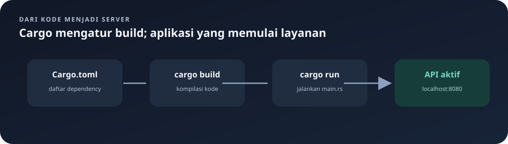

# `src/main.rs`

Titik masuk program. File ini membaca konfigurasi, menyiapkan PostgreSQL, menyusun aplikasi Actix, dan menjalankan server.

Navigasi: [indeks](README.md) · [konfigurasi](env.md) · [state](state.md) · [routing](routes.md).

> **Inti bab:** `main.rs` menyiapkan konfigurasi dan database lebih dulu; setelah itu baru memasang route, middleware session, dan server HTTP.

File sumber: [main.rs](../src/main.rs).

## Urutan Besar Startup



```text
.env → validasi konfigurasi → pool PostgreSQL → siapkan tabel
    → siapkan session key → susun Actix + routes → bind host:port → layani request
```

Server belum menerima request sampai seluruh tahap sebelum `.run().await` berhasil. Jadi kesalahan database atau session key biasanya muncul saat startup, bukan sebagai response HTTP.

## Modul dan Import

`mod db;`, `mod handlers;`, `mod models;`, `mod routes;`, `mod state;`, dan `mod auth_middleware;` memasukkan modul lokal. Modul satu file memakai nama `.rs`; modul folder dideklarasikan lewat `mod.rs`.

- `actix_web::{web, App, HttpServer}`: state/configuration, aplikasi, dan server.
- `PgPoolOptions`: konfigurasi pool koneksi PostgreSQL SQLx.
- `AppState`: wadah state aplikasi.
- `env`, `Duration`: membaca variabel lingkungan dan menyatakan timeout.
- `CookieSessionStore`, `SessionMiddleware`, dan `Key`: menyimpan session dalam cookie serta melindunginya dengan kunci rahasia.

## `main`

`#[actix_web::main]` menyediakan runtime asynchronous Actix. `async fn main() -> std::io::Result<()>` dapat menunggu operasi jaringan dan mengembalikan error I/O.

1. `dotenvy::dotenv().ok()` mencoba memuat `.env`. `dotenv()` menghasilkan `Result`; method `.ok()` mengubah `Result` menjadi `Option`, membuang informasi error. Karena nilai hasilnya tidak dipakai, file `.env` boleh tidak ada tanpa menghentikan proses. Ini tidak berarti semua konfigurasi opsional: `DATABASE_URL` tetap diperiksa setelahnya.
2. `env::var("DATABASE_URL").expect(...)` mengambil URL DB wajib. `env::var` menghasilkan `Result<String, VarError>`: `Ok(String)` jika ada, atau `Err(VarError)` jika tidak ada. `expect("pesan")` mengambil isi `Ok`; jika nilainya `Err`, program panic dan menampilkan pesan tersebut.
3. `HOST` dibaca atau memakai default `127.0.0.1` melalui `unwrap_or_else`; rincian ekspresi ini dijelaskan pada bagian khusus di bawah.
4. `PORT` dibaca atau memakai `8080`, kemudian `parse::<u16>()` memvalidasi bahwa isinya angka dalam rentang tipe tersebut. Hasil parse adalah `Result`; `.expect(...)` menghentikan startup dengan pesan yang mudah dipahami jika teks port tidak sah.
5. `PgPoolOptions::new()` membuat konfigurasi pool. `max_connections(5)` membatasi hingga lima koneksi, dan `acquire_timeout(Duration::from_secs(10))` membatasi waktu tunggu memperoleh koneksi.
6. `.connect(&database_url).await` membuat koneksi pool. `expect` menghentikan proses jika database tidak dapat dijangkau.
7. `db::initialize_database(&pool).await` menyiapkan tabel `menus`, `orders`, dan `"user"`; kegagalan menghentikan startup.
8. `SESSION_KEY` dibaca dan diubah menjadi array 64 byte. Jika tidak ada atau panjangnya salah, `expect` menghentikan startup. Nilai tersebut kemudian dibuat menjadi `Key`.
9. `println!` menampilkan alamat server.
10. `HttpServer::new(move || ...)` menyusun aplikasi per worker. `move` menangkap pool dan key ke dalam closure; `pool.clone()` membuat handle pool tambahan.
11. `App::new()` membuat aplikasi. `.app_data(...)` membagikan `AppState`; `.configure(routes::configure)` mendaftarkan endpoint; `SessionMiddleware` mengaktifkan session cookie.
12. `.bind((host, port))?` mengikat alamat server dan meneruskan error dengan `?`; `.run().await` menjalankannya.

Pesan error untuk `DATABASE_URL` menyarankan menyalin `.env.example`, tetapi file contoh itu tidak tersedia di proyek ini. Buat `.env` sendiri mengikuti pola dan penjelasan di [panduan konfigurasi](env.md); jangan menyalin rahasia dari file lokal ke dokumentasi atau Git.

Session memakai `CookieSessionStore`, sehingga datanya disimpan di cookie client dan dilindungi dengan `Key`. Isi session saat ini adalah `user_id`, bukan password. `.cookie_secure(false)` memudahkan pengembangan lokal melalui HTTP; untuk production gunakan HTTPS dan `.cookie_secure(true)`.

## Istilah

- **Async** memungkinkan fungsi menunggu I/O tanpa memblokir thread selama menunggu; `.await` mengambil hasil operasi asynchronous.
- **Pool** mengelola koneksi agar dapat dipakai ulang.
- `?` meneruskan error dari fungsi jika operasi gagal.
- `expect` mengambil hasil sukses atau menghentikan program dengan pesan yang diberikan.

<details>
<summary>🔎 Pendalaman: membaca ekspresi Rust di main.rs</summary>

Bagian ini membedah fallback environment, parsing port, closure, dan penanganan error. Untuk gambaran dasar, cukup ingat urutan startup di atas.

## Memahami `unwrap_or_else`

Kode:

```rust
let host = env::var("HOST").unwrap_or_else(|_| "127.0.0.1".to_string());
```

Langkah bacanya:

1. `env::var("HOST")` mencoba membaca variabel lingkungan dan menghasilkan `Result<String, VarError>`.
2. `unwrap_or_else(...)` memeriksa hasil tersebut. Jika `Ok(host)`, isi `String` itu langsung dipakai. Jika `Err(error)`, fungsi closure di dalam tanda kurung dipanggil dan nilai hasil closure menjadi default.
3. `|_| ...` adalah closure (fungsi kecil tanpa nama). Teks di antara garis `|` adalah parameter closure. `_` berarti parameter error ada tetapi tidak digunakan.
4. `"127.0.0.1".to_string()` mengubah string literal `&str` menjadi `String`, supaya tipe nilai default sama dengan nilai sukses `env::var`.

Jadi `unwrap_or_else` berbeda dari `expect`: `expect` menghentikan program ketika terjadi `Err`, sedangkan `unwrap_or_else` memulihkan alur dengan membuat nilai pengganti. Untuk `HOST`, fallback-nya alamat lokal; untuk `PORT`, fallback-nya teks `8080`.

## Potongan `PORT` Dibaca Bertahap

```rust
let port = env::var("PORT")
	.unwrap_or_else(|_| "8080".to_string())
	.parse::<u16>()
	.expect("PORT harus berupa angka yang valid");
```

- Pemanggilan method berantai (`.method()`) menjalankan operasi pada hasil method sebelumnya.
- `unwrap_or_else` menghasilkan `String` baik dari environment maupun default.
- `parse::<u16>()` mencoba mengubah string menjadi angka bertipe `u16`. `::<u16>` adalah argumen tipe eksplisit agar compiler tahu jenis angka yang diinginkan.
- `parse` juga menghasilkan `Result`, karena teks bisa gagal dikonversi. `expect` menghentikan startup jika parse gagal.
- `u16` adalah integer tanpa tanda 16-bit; karena itu port harus berupa angka yang cocok dengan rentang tipe tersebut.

## Sintaks Rust Lain pada File Ini

- `use a::{B, C};` mengimpor beberapa nama dari modul `a` agar dapat dipakai tanpa menulis path lengkap setiap kali.
- `mod nama;` mendeklarasikan modul lokal; `pub` tidak dipakai pada deklarasi ini sehingga akses modul dibatasi sesuai aturan modul crate.
- `async fn` mendeklarasikan fungsi asynchronous. `.await` menunggu hasil operasi asynchronous seperti koneksi atau server.
- `&database_url` dan `&pool` adalah referensi: fungsi yang dipanggil meminjam nilai, bukan mengambil kepemilikannya.
- `move || { ... }` adalah closure tanpa parameter. `move` memindahkan nilai yang dipakai closure ke dalam closure agar dapat hidup bersama server. Ini diperlukan karena server berjalan setelah fungsi setup melanjutkan alurnya.
- `pool.clone()` membuat handle pool tambahan yang merujuk pada resource pool yang dikelola SQLx; bukan menyalin semua data database.
- `session_key.clone()` memberikan key yang sama ke aplikasi worker agar semuanya dapat membaca cookie session.
- `SessionMiddleware` dipasang pada aplikasi agar extractor `Session` dan `SessionExt` dapat membaca cookie request.
- `AppState { db: pool.clone() }` membuat nilai struct dengan mengisi field `db`.
- `.bind((host, port))?` mengikat server ke tuple alamat `(host, port)`. `?` mengembalikan error dari `main` bila operasi gagal; tipe return `std::io::Result<()>` memungkinkan error I/O tersebut dikembalikan.
- `println!("...{host}:{port}")` adalah macro untuk menulis ke terminal. `{host}` dan `{port}` adalah capture format string yang mengambil variabel bernama sama.

</details>

## Tipe Hasil dan Penanganan Gagal

Rust memakai `Result<T, E>` untuk operasi yang dapat gagal dan `Option<T>` untuk nilai yang bisa ada atau tidak ada. Di file ini, pembacaan environment dan koneksi memakai `Result`; nilai opsional `HOST`/`PORT` ditangani dengan default. Strategi penanganan berbeda sesuai kebutuhan: nilai default untuk server, pesan eksplisit untuk konfigurasi wajib, dan `?` untuk error pengikatan socket yang dikembalikan ke runtime pemanggil. Jika persiapan tabel gagal, startup berhenti sebelum server HTTP menerima request.

---

Kembali ke [indeks catatan](README.md) atau lanjut ke [state aplikasi](state.md).
