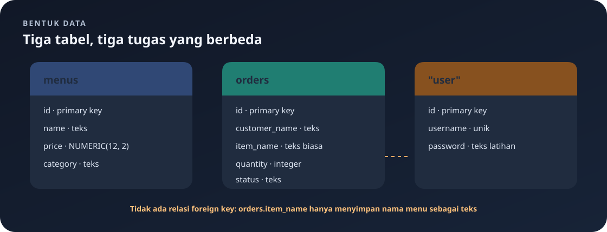

# `src/models.rs`

File ini mendefinisikan tipe data untuk input JSON dan hasil database.

Navigasi: [indeks](README.md) · [skema database](db.md) · [routing](routes.md) · [handler menu](handlers/menus.md) · [handler pesanan](handlers/orders.md).

> **Inti bab:** model adalah cetakan bentuk data. Input lengkap, input PATCH, dan hasil database dipisahkan supaya kebutuhan tiap operasi jelas.

File sumber: [models.rs](../src/models.rs).

## Peta Model



| Operasi | Menu | Pesanan | Peran |
|---|---|---|---|
| Hasil baca/tulis | `MenuItem` | `Order` | Row database yang dapat diserialisasi ke JSON. |
| Create dan PUT | `MenuInput` | `OrderInput` | Body lengkap; tidak membawa `id`. |
| PATCH | `MenuPatchInput` | `OrderPatchInput` | Field opsional; `None` berarti pertahankan nilai lama. |

Model menentukan **bentuk** data, bukan apakah nilai itu masuk akal. Aturan seperti harga positif dijalankan handler setelah JSON berhasil dibaca.

## Import dan Atribut

- `Decimal`: angka desimal presisi, cocok untuk harga.
- `Deserialize`: mengubah JSON request menjadi struct.
- `Serialize`: mengubah struct menjadi JSON response.
- `FromRow`: memungkinkan SQLx memetakan row query ke struct.
- `Debug`: memungkinkan nilai dicetak untuk debugging.
- `#[derive(...)]`: meminta compiler menghasilkan implementasi trait tersebut.

## Menu

### `MenuItem`

Hasil query menu. Handler create/update/patch juga dapat menserialisasikannya sebagai response object. `id: i32` adalah ID; `name: String` nama; `price: Decimal` harga; `category: String` kategori. Derive `Serialize` dan `FromRow` mendukung JSON dan pemetaan SQLx.

### `MenuInput`

Body lengkap untuk POST dan PUT. Field wajib: `name: String`, `price: Decimal`, `category: String`. Tidak memiliki ID karena database yang membuat ID. Validasi isinya dilakukan handler.

### `MenuPatchInput`

Body PATCH. Field `name`, `price`, `category` masing-masing bertipe `Option` dari tipe nilai biasa. `Some(nilai)` berarti minta perubahan; `None` berarti biarkan nilai lama. Handler menolak jika semua `None`.

## Pesanan

### `Order`

Hasil query/response: `id: i32`, `customer_name: String`, `item_name: String`, `quantity: i32`, `status: String`. Derive `Serialize` dan `FromRow` mendukung JSON dan SQLx.

### `OrderInput`

Input lengkap POST/PUT. Semua field wajib: `customer_name: String`, `item_name: String`, `quantity: i32`, `status: String`. Validasi teks kosong dan jumlah positif dilakukan handler.

### `OrderPatchInput`

Input PATCH dengan empat field yang semuanya `Option`: tiga `Option<String>` dan satu `Option<i32>`. `None` mempertahankan nilai yang sudah tersimpan.

## Data Login

Struct `Credentials` tidak berada di `models.rs`; ia didefinisikan di `src/handlers/auth.rs` karena saat ini hanya dipakai oleh handler autentikasi. Field `username: String` dan `password: String` menerima body register/login. Struct ini hanya derive `Deserialize`, sehingga dipakai untuk membaca JSON request, bukan untuk menampilkan password di response.

Contoh bentuk request:

```json
{
	"username": "yofan",
	"password": "password-yang-kuat"
}
```

Pada versi latihan ini, password disimpan sebagai teks biasa pada kolom `password`. Ini sengaja menyederhanakan contoh dan tidak aman untuk aplikasi nyata. Jangan gunakan password sungguhan atau memakai pendekatan ini di production.

## Mengapa Struct Dipisah?

Model hasil database membawa `id`, tetapi input klien tidak perlu mengirim ID. Input lengkap meminta semua field, sedangkan input patch mengizinkan sebagian. Pemisahan ini membuat bentuk data di setiap operasi eksplisit.

<details>
<summary>🔎 Pendalaman: sintaks Rust dan Serde pada model</summary>

Gunakan bagian ini sebagai kamus saat bertemu `derive`, `Option`, atau referensi. Ringkasan bentuk model sudah ada di tabel awal.

## Penjelasan Sintaks Rust pada File Ini

### `use` dan path tipe

`use rust_decimal::Decimal;` membawa nama `Decimal` dari crate `rust_decimal` ke lingkup file. Tanpa import, tipe harus ditulis lengkap sebagai `rust_decimal::Decimal`. Tanda `::` memisahkan nama crate/modul dari item di dalamnya.

`use serde::{Deserialize, Serialize};` adalah grouped import: dua nama diambil dari modul `serde` sekaligus. `{ ... }` di sini bukan struct literal, tetapi daftar nama yang diimpor.

### Atribut `derive`

`#[derive(Debug, Serialize, FromRow)]` adalah atribut yang diproses compiler/macro sebelum kode Rust biasa dikompilasi. Ia menghasilkan implementasi trait untuk struct berikutnya:

- `Debug`: format debug untuk inspeksi, misalnya `println!("{value:?}")`.
- `Serialize`: membuat nilai menjadi representasi yang bisa ditulis sebagai JSON oleh Serde.
- `Deserialize`: membaca representasi seperti JSON menjadi nilai Rust.
- `FromRow`: memberi SQLx cara membangun struct dari kolom-kolom satu row query.

Derive hanya tersedia bila tipe field mendukung trait yang diminta. Contohnya `MenuItem` tidak derive `Deserialize` karena kode tidak memakai `MenuItem` sebagai body input.

### `pub`, struct, dan field

`pub struct MenuItem { ... }` mendeklarasikan tipe bernama `MenuItem` yang dapat dipakai modul lain. `pub` sebelum setiap field juga membuat field dapat dibaca dari modul lain. Tanpa `pub` pada field, struct mungkin dapat disebut di luar modul tetapi field privatnya tidak dapat diakses langsung.

Field ditulis dalam bentuk `nama: Tipe`. Koma memisahkan field. `String` adalah teks yang memiliki data sendiri; `i32` adalah bilangan bulat bertanda 32-bit; `Decimal` adalah bilangan desimal presisi.

### `Option<T>` dan nilai patch

`Option<T>` adalah enum standar Rust untuk nilai yang mungkin ada atau tidak ada. Dua kemungkinan utamanya:

- `Some(nilai)`: nilai tersedia.
- `None`: nilai tidak tersedia.

Contoh, `price: Option<Decimal>` tidak berarti harga boleh disimpan kosong pada database. Di request PATCH, `None` berarti klien tidak meminta kolom harga diubah. Handler mengubah `None` menjadi parameter SQL `NULL`, lalu SQL `COALESCE` memilih harga lama.

Perhatikan bahwa JSON `null` untuk field `Option` dideserialisasi sebagai `None`, sama seperti field opsional yang tidak dikirim untuk konfigurasi Serde default pada struct ini. Dengan rancangan sekarang keduanya sama-sama berarti “tidak mengubah field”, bukan mengosongkan harga.

### `String` dibanding `&str`

Field input memakai `String`, yaitu teks yang dimiliki struct. Ketika handler memanggil `name.trim()`, `trim()` menghasilkan potongan teks `&str` yang meminjam bagian dalam string tanpa whitespace tepi; ia tidak mengubah `String` asal. Parameter query kemudian dibind saat pemanggilan SQLx.

</details>

## Hubungan Nama Field dan Database/JSON

Tidak ada atribut Serde seperti `rename` di file ini. Karena itu nama field mengikuti nama Rust saat JSON diserialisasi/deserialisasi, misalnya `customer_name` tetap ditulis sebagai `customer_name` (snake_case). `FromRow` SQLx juga memetakan nama kolom yang dipilih ke field yang namanya sama. Query handler sengaja memilih kolom dengan nama yang sesuai struct.

## Yang Tidak Dilakukan oleh Model

Struct dan derive hanya mendefinisikan bentuk data dan konversi. Mereka tidak memeriksa harga positif, nama tidak kosong, atau quantity lebih dari nol. Pemeriksaan tersebut berada di `validate_menu`, `validate_order`, dan logika PATCH pada handler. `Deserialize` juga dapat gagal pada JSON yang bentuk/tipe nilainya tidak cocok; Actix menangani kegagalan ekstraksi body sebelum fungsi handler berjalan.

---

Kembali ke [indeks catatan](README.md) atau lanjut ke [skema database](db.md).
