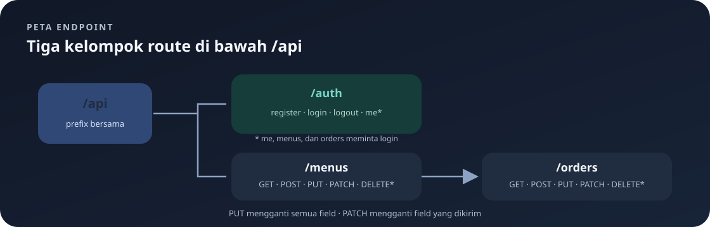

# `src/routes.rs`

File ini mendaftarkan pasangan metode HTTP dan path, lalu menghubungkannya ke handler.

Navigasi: [indeks](README.md) · [middleware](auth-middleware.md) · [handler autentikasi](handlers/auth.md) · [contoh `curl`](akses_curl.md).

> **Inti bab:** route mencocokkan metode HTTP dan URL, lalu mengarahkan request ke handler. Scope route juga menentukan middleware login.

File sumber: [routes.rs](../src/routes.rs).

`actix_web::web` menyediakan API route/scope. `from_fn` memasang middleware pada scope. Modul handler yang digunakan adalah `auth`, `menus`, dan `orders`; fungsi `require_login` berasal dari `auth_middleware.rs`.

## Fungsi `configure`



`pub fn configure(config: &mut web::ServiceConfig)` menerima konfigurasi service yang dapat diubah. Fungsi ini dipasang dari `main.rs` lewat `.configure(routes::configure)`.

| Metode | Path | Handler | Kegunaan |
|---|---|---|---|
| GET | `/api/menus` | `menus::get_menus` | Daftar menu; dapat meminta satu kolom dengan `?field=...`. |
| POST | `/api/menus` | `menus::create_menu` | Membuat menu. |
| GET | `/api/menus/{id}` | `menus::get_menu` | Detail satu menu. |
| PUT | `/api/menus/{id}` | `menus::update_menu` | Mengganti seluruh field menu. |
| PATCH | `/api/menus/{id}` | `menus::patch_menu` | Mengganti sebagian field menu. |
| DELETE | `/api/menus/{id}` | `menus::delete_menu` | Menghapus menu. |
| GET | `/api/orders` | `orders::get_orders` | Daftar pesanan; dapat meminta satu kolom. |
| POST | `/api/orders` | `orders::create_order` | Membuat pesanan. |
| GET | `/api/orders/{id}` | `orders::get_order` | Detail satu pesanan. |
| PUT | `/api/orders/{id}` | `orders::update_order` | Mengganti seluruh field pesanan. |
| PATCH | `/api/orders/{id}` | `orders::patch_order` | Mengganti sebagian field pesanan. |
| DELETE | `/api/orders/{id}` | `orders::delete_order` | Menghapus pesanan. |
| POST | `/api/auth/register` | `auth::register` | Membuat akun; tidak perlu login. |
| POST | `/api/auth/login` | `auth::login` | Memeriksa akun dan membuat session cookie. |
| POST | `/api/auth/logout` | `auth::logout` | Menghapus session dari cookie yang dikirim. |
| GET | `/api/auth/me` | `auth::me` | Melihat akun yang sedang login; perlu login. |

Semua route menu dan pesanan dilindungi `require_login`, begitu pula `/api/auth/me`. Register dan login sengaja terbuka supaya pengguna dapat membuat akun dan memulai session. Logout tidak dilindungi middleware sehingga handler dapat menghapus session jika cookie tersedia.

### Pembagian akses

| Route | Perlu session? | Alasannya |
|---|:---:|---|
| `/api/auth/register`, `/api/auth/login` | Tidak | Pengguna harus bisa membuat akun dan memulai sesi. |
| `/api/auth/logout` | Tidak | Menghapus sesi yang dikirim, bila ada. |
| `/api/auth/me` | Ya | Membaca identitas dari session. |
| `/api/menus/*`, `/api/orders/*` | Ya | Seluruh operasi data berada di scope terlindungi. |

Tanda `*` pada tabel hanya ringkasan seluruh route di bawah prefix; bukan wildcard yang dikirim sebagai URL literal.

`web::scope("/api")` memberi prefix API; scope `/menus` dan `/orders` menambahkan prefix berikutnya. `.route("", ...)` mendaftarkan path dasar scope. `/{id}` adalah segmen dinamis, diekstrak handler sebagai `web::Path<i32>`. `web::get()`, `post()`, `put()`, `patch()`, dan `delete()` menetapkan metode; `.to(...)` menentukan fungsi tujuan.

File ini hanya melakukan routing. Validasi dan query ada di handler.

## Urutan Memakai Session

1. Kirim `POST /api/auth/register` dengan JSON `username` dan `password` untuk membuat akun.
2. Kirim `POST /api/auth/login` dengan kredensial yang sama. Jika benar, server membuat session dan mengirim cookie.
3. Pastikan client seperti Postman menyimpan cookie tersebut.
4. Kirim request menu, pesanan, atau `/api/auth/me` dengan cookie yang sama. Middleware memeriksa session sebelum handler bekerja.
5. Kirim `POST /api/auth/logout` untuk menghapus isi session.

Cookie yang hilang atau tidak valid membuat route terlindungi merespons `401 Unauthorized`. Session hanya membuktikan bahwa pengguna sudah login; implementasi saat ini belum membedakan role atau hak akses pengguna.

<details>
<summary>🔎 Pendalaman: membaca konfigurasi route di Rust</summary>

Pembahasan ini menjelaskan signature, builder, dan cara scope menggabungkan path. Kamu bisa membukanya saat mulai menelusuri implementasi `routes.rs`.

## Memahami Sintaks Fungsi

Pada `pub fn configure(config: &mut web::ServiceConfig)`, `pub` berarti fungsi dapat dipanggil dari modul lain; `fn` mendeklarasikan fungsi biasa (tidak asynchronous); `config` adalah nama parameter; `&mut` berarti fungsi menerima pinjaman yang boleh diubah; `web::ServiceConfig` adalah tipe konfigurasi Actix. Fungsi tidak menulis tipe return, sehingga return-nya unit `()` secara implisit.

`crate::handlers` berarti mulai pencarian dari root crate saat ini, lalu masuk ke modul `handlers`. Bentuk `use crate::handlers::{auth, menus, orders};` mengimpor tiga submodul handler sekaligus.

## Builder dan Rangkaian Pemanggilan

Pola berikut adalah method chaining:

```rust
config.service(
	web::scope("/api")
		.service(web::scope("/menus").route("", web::get().to(menus::get_menus)))
)
```

- `config.service(...)` menambahkan satu service ke konfigurasi aplikasi.
- `web::scope("/api")` membuat scope dengan prefix path.
- Pemanggilan `.service(...)` yang berikutnya memasukkan scope anak.
- `.route(path, guard)` menambahkan satu pasangan path dan aturan metode/handler.
- `web::get()` membuat konfigurasi route khusus metode GET; `.to(...)` mengubah fungsi handler menjadi tujuan route yang dapat dipanggil Actix.

Builder mengembalikan objek konfigurasi berikutnya, sehingga beberapa pemanggilan dapat dirangkai. Tanda titik di awal baris hanyalah pemformatan; method tersebut tetap bagian dari ekspresi sebelumnya.

## Scope dan Penggabungan Path

Scope bersarang menggabungkan prefix. Scope `/api` yang berisi scope `/menus`, yang berisi route `/{id}`, menghasilkan `/api/menus/{id}`. Route path `""` berarti tidak menambah segmen setelah scope, jadi menjadi `/api/menus` atau `/api/orders`. Scope `/auth` menghasilkan path seperti `/api/auth/login`.

`{id}` adalah placeholder segment pada path Actix, bukan format interpolasi Rust. Nilainya diekstrak kemudian oleh handler melalui extractor `web::Path<i32>`. Karena tipe target integer, URL seperti `/api/menus/abc` tidak dapat diekstrak sebagai `i32` dan akan ditolak oleh framework sebelum handler mendapatkan ID.

## Metode HTTP Bukan Validasi Isi

Pendaftaran `web::post()` hanya memilih metode HTTP. JSON body, validasi bisnis, query, dan response dikerjakan handler. Demikian pula route GET dengan query `?field=...` tidak didaftarkan terpisah; satu handler membaca query tersebut dan memilih kolom.

## Arti Prefix `web::`

`web` adalah modul Actix yang diimpor dari `actix_web`. Notasi `web::scope`, `web::get`, dan lainnya berarti mengakses item bernama itu di modul `web`, bukan fungsi lokal dalam file ini.

</details>

---

Kembali ke [indeks catatan](README.md) atau lanjut ke [middleware autentikasi](auth-middleware.md).
