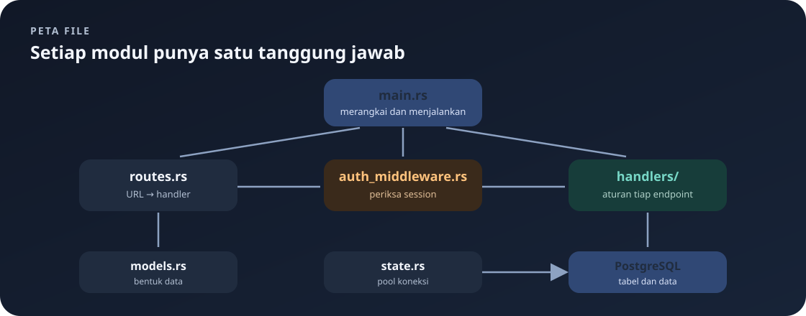

# `src/state.rs`

File ini menyediakan state aplikasi yang diperlukan banyak handler.

Navigasi: [indeks](README.md) · [startup](main.md) · [model data](models.md).

> **Inti bab:** `AppState` menyimpan `PgPool`, yaitu handle bersama untuk memakai koneksi PostgreSQL dari handler.

File sumber: [state.rs](../src/state.rs).

`use sqlx::PgPool;` mengimpor handle pool PostgreSQL.



```rust
pub struct AppState {
    pub db: PgPool,
}
```

`AppState` adalah struct publik agar dapat digunakan modul lain. Field publik `db` menyimpan pool SQLx. `main.rs` membuatnya dengan `AppState { db: pool.clone() }`, lalu membungkusnya dalam `web::Data`. Handler menu, pesanan, dan autentikasi menerima `web::Data<AppState>` dan menjalankan query melalui `state.db`.

`web::Data` adalah mekanisme Actix untuk membagikan data aplikasi dan mengekstraknya dalam handler. Pool bukan salinan isi database; clone pool adalah handle tambahan yang tetap mengacu pada pool yang dikelola SQLx.

## Session Tidak Disimpan di `AppState`

Session bukan field di `AppState`. `actix-session` membaca cookie request melalui parameter `Session` pada handler atau `request.get_session()` pada middleware. Jadi pool database adalah state bersama aplikasi, sementara identitas login berasal dari session request yang sedang diproses.

Alur dependency-nya:

```text
main.rs membuat PgPool
       ↓ clone handle
AppState { db }
       ↓ web::Data<AppState>
handler menerima state dan memakai state.db untuk query
```

## Mengurai Sintaks File

- `use sqlx::PgPool;` mengimpor nama `PgPool` agar tipe field dapat ditulis singkat.
- `pub struct AppState { ... }` mendeklarasikan tipe data baru bernama `AppState`. `pub` membuat tipenya dapat digunakan dari modul lain.
- `pub db: PgPool` menyatakan field bernama `db`, bertipe `PgPool`. `pub` kedua membuat field dapat diakses dari modul handler.
- `AppState { db: pool.clone() }` adalah struct literal: membuat nilai `AppState` dan memberikan nilai untuk field `db`. Jika nama variabel dan field sama, Rust juga mengizinkan shorthand `AppState { db }`; kode ini menuliskan nama field dan ekspresi secara eksplisit.
- `pool.clone()` memanggil method `clone` untuk membuat handle lain. Pool SQLx dirancang untuk dibagikan; clone ini bukan penggandaan semua koneksi atau seluruh data di PostgreSQL.
- `web::Data::new(...)` membuat pembungkus data aplikasi yang cocok dengan mekanisme Actix. Handler meminta nilai itu sebagai parameter `web::Data<AppState>`.
- `state.db` mengakses field publik `db` dari parameter bernama `state`. Deref yang disediakan `web::Data` membuat field state dapat diakses langsung.

## Mengapa Tidak Menaruh Semua di Handler?

`AppState` memisahkan dependency bersama dari logika endpoint. Saat ini hanya ada pool DB. Jika field state berubah, pembuatan state di `main.rs` dan kebutuhan handler yang menggunakannya perlu tetap konsisten.

---

Kembali ke [indeks catatan](README.md) atau lanjut ke [model data](models.md).
